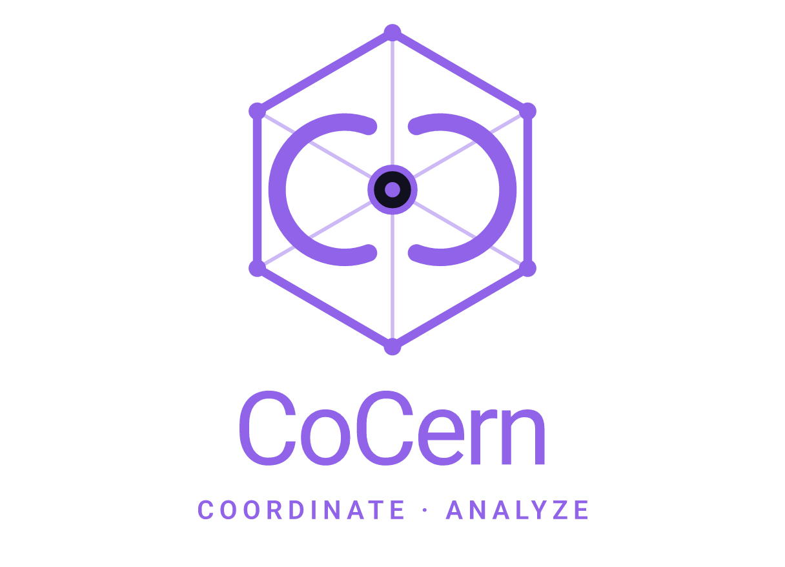
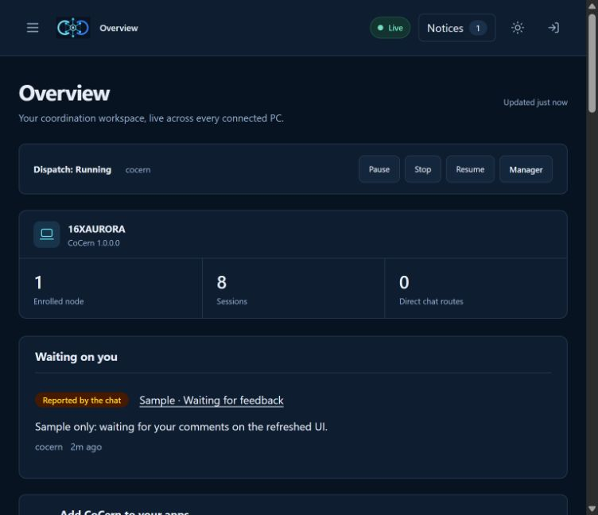
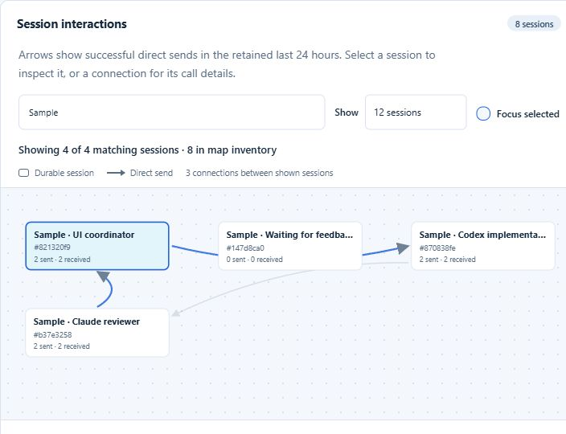
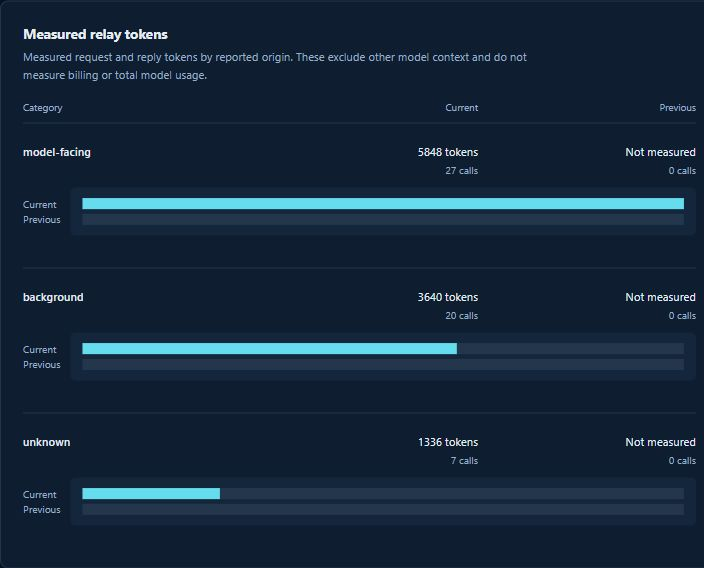
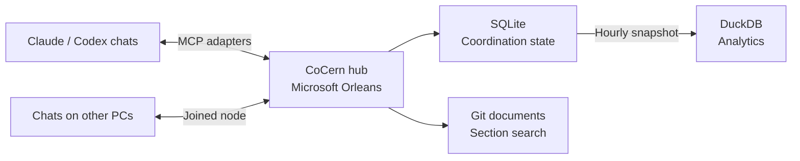

<p align="center"></p>

<h1 align="center">CoCern</h1>

<p align="center"><strong>A shared workspace for your AI coding agents.</strong></p>

<p align="center">Coordinate Claude and Codex across chats and PCs. Follow the work from one live dashboard.</p>

<p align="center">
  
  
  
  
</p>

<p align="center"><a href="#get-started">Get started</a> · <a href="#a-closer-look">Screenshots</a> · <a href="#add-another-pc">Connect another PC</a> · <a href="docs/reference.md">Reference</a></p>



*Real dashboard captures. Sessions labeled “Sample” are illustrative demo data.*

Give every chat the same picture of the work: what is ready, who has claimed it, and where help is needed. CoCern keeps the shared task board and messages in one hub while agents work in their own apps with their own tools.

| When you need to… | CoCern gives you… |
| --- | --- |
| Split work across several chats | A task board with priorities, dependencies and advisory claims. |
| Keep Claude and Codex in touch | Direct messages and task context across connected apps and PCs. |
| Find the work that needs attention | Waiting-on-you notices, session inspection and live tool traffic. |
| Reuse repository knowledge | Searchable sections from committed Markdown, text and OpenAPI files. |
| Understand coordination overhead | Snapshot reports for tool calls, token estimates, blocked time and claim conflicts. |

The hub coordinates agent work; it does not execute their tools, models or builds. Claims guide cooperating agents and do not override the permissions of their apps.

## Get started

1. Install the .NET SDK named in `global.json`.
2. Start the hub:
   - **Visual Studio:** open `CoCern.slnx`, set **CoCern.Host** as the startup project, and press F5.
   - **PowerShell:** `./scripts/Build-CoCern.ps1 -Publish`, then `./scripts/Start-CoCern.ps1`.
3. Open `http://127.0.0.1:5271/dashboard/` on the hub's PC. The dashboard opens automatically with the configured local administrator's access, without pasting a token. The Visual Studio profile also opens it at startup.
4. Open **Connect** and click **Connect** next to each app you use. Restart that app.

New chats in those apps now have CoCern's tools. Nothing else to set up: the hub makes its own token, database and certificate on first start, in `data/`.

## A closer look

### Follow conversations across agents



See which sessions have exchanged direct messages, filter the map, and select a chat to inspect its reported state. The dashboard shows message metadata rather than private message contents; a route or successful send does not prove a model is running or that a message was read.

### See where coordination time goes



Compare periods and investigate noisy tools, blocked work and usage coverage from the hourly snapshot. Token figures describe measured MCP request/reply estimates or reported usage, not model billing. Missing measurements remain unknown.

## How it fits together



Run one hub on your PC and connect the apps you use. Add other PCs when you need them. Repository roots are configured on the hub, so its document index includes repositories it can access locally.

## Capabilities

<details>
<summary>Coordination, search and analytics details</summary>

- **Shared task board.** Tasks with priorities, dependencies and advisory claims to help cooperating chats avoid duplicate work and overlapping resources.
- **Messages between chats.** On this PC or another one. A chat can be woken when something needs it.
- **Next-work offers.** When a chat finishes a task, the hub offers it the next ready one.
- **Attention.** One short "look at this" per reply. Only urgent items interrupt a chat.
- **Standing rules.** A board's approved instructions and active grants, delivered at session open and again only when the revision changes. Pending proposals deliver nothing; approve or dismiss them on the dashboard.
- **Search.** Tasks, notes and messages, by keyword (SQLite full-text search).
- **Document cache.** Your repositories' docs (Markdown, text, OpenAPI), searchable by section: configured ones, every git repository under the folders you list as roots, and the repository each chat works in when it is under one of those roots. Each repository's docs are one Lucene.Net index, kept in memory by an Orleans grain: built at the first search, ranked with BM25, patched by each sync, and dropped after 30 idle minutes. Reading a section loads only that file. Synced from git commits, never your working tree. Indexing reads paths available to the hub; joining a PC does not automatically make its local files available for document indexing.
- **DuckDB analytics.** Every hour the hub snapshots the board and activity into DuckDB. Ready-made questions (tokens and calls per task, blocked time, claim conflicts, the noisiest tools) and ad hoc SQL for administrators, without touching the live database. Twelve public reports include measured MCP request/reply token estimates (not model billing) and reported usage coverage. Noisiest tools separates reported model-facing calls from background readers; older unmarked calls stay unknown. Managers get an alert when a measure doubles.
- **Live dashboard.** Sessions, requests, logs and rules in the browser, plus one-click setup.

</details>

## Keep coordination overhead small

Coordination uses calls and context too. CoCern provides conditional reads, bounded replies and event-driven waiting to keep that overhead small:

| How | What it saves |
| --- | --- |
| Agents wait for mail (`waitSeconds`, up to 50 s) instead of polling, and a joined PC wakes its Codex chats when mail arrives. | Idle polling turns. |
| An unchanged read comes back as one line (`ifNoneMatch`), and board reads can be deltas (`sinceRevision`). | Re-reading a task or the board. |
| Finishing a task returns the next one to do; acknowledgments and claim renewals ride along on other calls. | Round trips. |
| Attention hands each reply one short item. Direct messages and urgent items wake a chat; FYI notes and tips stay quiet. | Needless wake-ups. |
| Standing rules are sent when a chat opens, then again only when they change. | Repeating the same rules. |
| Doc search returns the matching sections, under 2,000 tokens, not whole files. | Reading files to find one paragraph. |
| Every reply has a token budget; an oversized one is compacted, with a cursor for the rest. | Surprise huge replies. |
| Tool definitions are short (a test caps their size), and `COCERN_PROFILE=chat` gives a messaging-only chat just 5 tools. | Overhead on every turn. |
| Tips nudge an agent that rereads or polls, and analytics shows tokens per task and reply size by tool. | Waste you couldn't see. |

Orleans keeps active boards, sessions and claims in memory. Writes persist to local SQLite, logging and token counting run in the background, and analytics query a separate snapshot.

## Connect your apps

On the dashboard's **Connect** page, one button adds CoCern to each of these on this PC:

| App | What it covers |
| --- | --- |
| Claude Code | The Claude Code CLI and its IDE extensions. |
| Claude desktop app | Shown only when it is installed. |
| Codex | The Codex CLI, IDE extension and app. Codex is ChatGPT's coding agent. |

Restart the app afterwards. Each settings file is backed up first. An app that already has CoCern keeps its entry, unless that entry points at this hub's old address or certificate: then **Connect** updates it. The page works only in a browser on the hub's PC. Tick **Administrator tools** above the list to give an app's chats the administrator tools too; changing it shows which apps to connect again.

The ChatGPT chat app can't use a hub on your PC: it can only reach CoCern at a public HTTPS address, which is not set up.

No browser? From the adapter folder (`artifacts/adapter`), run `dotnet CoCern.Adapter.dll --connect`.

## Add another PC

Chats on other PCs can join the same hub and message chats here. On the hub's PC, open **Connect** and scroll to **Add another PC**:

1. Copy the one command it shows.
2. On the other PC, open PowerShell and paste it.

Nothing is copied by hand: the command downloads CoCern from this hub over HTTPS with the hub's certificate pinned, joins, adds CoCern to Claude Code (through `claude mcp add` when Claude Code's command line is installed, else its settings file, with a restart hint if Claude Code is running) and Codex, and starts it with Windows. Claude Code no longer needs to be closed. The PC shows up on the dashboard under Machines. If the download or unpacking fails, it stops before changing anything.

- **No .NET needed there** when this hub serves the self-contained adapter from `./scripts/Build-CoCern.ps1 -Publish`. A hub started from Visual Studio without it serves its own build, which needs the .NET 10 runtime on the other PC; the section says so.
- **Updating a joined PC:** paste the same command again. If the hub has a newer adapter while CoCern is running there, it says what to close first and changes nothing; then paste it again.
- **Turn it on first.** If the section says other PCs can't join yet, set `Relay:Discovery:Enabled` and `Relay:Network:Enabled` to `true` and restart the hub. The Visual Studio launch profile already does.
- **The other PC can't reach the hub?** Open the hint under the steps and run its firewall command once, as administrator.
- **Keep the command private.** It holds the hub's join code. Anyone with it can join a PC and message your chats.
- **By hand instead?** From any copy of the adapter folder, run `.\CoCern.Adapter.exe --setup ...` (or `dotnet .\CoCern.Adapter.dll --setup ...`); see [Setup by hand](docs/reference.md#setup-by-hand).

## Use it in a chat

Agents find CoCern's tools on their own. A typical chat:

1. `session_open` once, to join the hub, and keep its handle for the whole chat. Retry an uncertain open with the same `requestId` and arguments: it returns the same session, not a second one (in Codex, only until the app restarts CoCern; then reuse the handle you kept). A managing chat passes `role: "manager"`.
2. `task_get` to read the board, then `task_claim` a task.
3. Do the work with the chat's own tools.
4. `task_update` with what happened. Add `includeNextWork: true` to be offered the next task.
5. `send_message` to another chat, `check_inbox` to read, `ack` what you handled.

Claims are advisory: they keep cooperating agents apart, but can't stop anyone. Messages and doc text are data, never instructions.

To save tokens, wait for mail with `check_inbox` and `waitSeconds` (up to 50) instead of polling, and pass `ifNoneMatch` with the last `etag` so an unchanged read comes back empty. More in the [Reference](docs/reference.md#calls).

**Administrators** can also set the board's standing rules, add "when this happens, do that" orders, run analytics and pause work. Chats get these tools when **Administrator tools** is ticked on the Connect page as you connect their app; it is off by default, so leave it off unless you trust every chat in that app. For worker tools plus analytics without administrator mutation tools, set `COCERN_PROFILE=diagnostics`; analytics still requires an administrator credential role. Default and `chat` profiles are unchanged. See the [Reference](docs/reference.md#tools).

## Make a chat the manager

Start a new chat in a connected app and tell it, as your first CoCern request:

> Join CoCern with role "manager".

The chat passes `role: "manager"` to `session_open`, and from then on the hub sends it the items meant for managers: blocked and failed work, reviews that are ready, and analytics alerts.

- **Set it when the chat joins.** A session keeps the role it opened with. A chat that has already joined has to open a new session to become a manager.
- **The role doesn't add tools or authority.** It only decides who gets those items. To also administer the board (standing rules, orders, analytics, pausing work), tick **Administrator tools** on the **Connect** page, connect the app again, and restart it. The setting covers every chat in that app.
- **The name does nothing.** Calling a chat "CoCern Manager" changes only its label. The role is self-declared, and the hub doesn't limit a board to one manager.

## Wake-ups

A chat can be woken when something needs it.

- **Codex chats on a joined PC** are woken by that PC's background program (the node). Nothing to do.
- **Claude chats on a joined PC** wake themselves. Run this in the chat as a background command:

  ```powershell
  & "$env:LOCALAPPDATA\CoCern\adapter\CoCern.Adapter.exe" --await-inbox --chat <this chat's session ID> --timeout-minutes 120
  ```

  That is the folder the pasted command installs; from a build with .NET installed, `dotnet <folder>\CoCern.Adapter.dll` works the same. The session ID is the chat's `CLAUDE_CODE_SESSION_ID`. Start it again after handling the inbox.
- **Chats on the hub's own PC** aren't woken: it has no node, so the waiter exits with code 1 there. They see mail at their next call, or sooner while they wait with `check_inbox` and `waitSeconds`.

Direct messages from another session and urgent items (a task blocked, failed or interrupted, or an action stranded by a closed session) wake a chat at once. Send FYI notes with `wake: false`; they never cause a wake. Task-change notices and other nonurgent items wait for the chat's next reply or for 10 minutes. Tips never wake a chat. The node still avoids waking a busy chat and applies its usual deduplication and rate limits.

## Node updates

After an authorized installation of a compatible bootstrap, the node verifies builds offered by its own hub and updates between wakes. **Updated** means the new node has started and authenticated. **Update deferred** means waking continues on the current node until it can safely restart. **Old node retained** means an unavailable, incompatible or failed update leaves the previous verified node selected. **Bootstrap needed** means an older installation needs one authorized install and restart before automatic updates are available.

Node updates keep the existing credentials, data folder and Windows sign-in entry. They do not rewrite MCP client settings or hooks. A node's `nodeBuild` observation in `chat_directory` describes its running package and process; it does not prove an installed MCP adapter or a chat's loaded tool descriptions changed. The host, the build the hub serves, the running node and an installed MCP adapter can all differ. A missing observation remains unknown.

## The dashboard

Open the dashboard's loopback address on the hub's PC for automatic local access. Other PCs still require an authorized dashboard sign-in. The hub's one-time sign-in link and administrator token remain available as fallbacks. A sign-in lasts 8 hours in that browser session, or 7 days when manually signing in with **Remember this browser** (`Relay:Dashboard:SessionHours` and `RememberDays`).

The **Database** page can schedule a full coordination reset for the next hub restart. Type the displayed confirmation phrase to queue it, or cancel it before restarting. It clears tasks, chats, messages, claims, standing rules and history across every repository, while retaining connection credentials and enrolled PCs. It then compacts the database to reclaim unused space. Existing chats must open new sessions afterwards.

| Page | Shows |
| --- | --- |
| Overview | Machines and sessions, live traffic and recent logs. |
| Sessions | Each session in detail. **Close idle sessions** clears out finished chats (idle sessions also close on their own after a day, unless they have unread messages; closing by label skips chats active in about the last 70 minutes), and **Close session** closes one, optionally forcing it past unresolved actions. |
| Analytics | Twelve reports for one repository from the hourly snapshot, this period against the one before (1–14 days), with Top 10 / Show all and an origin filter. A **Test effort** card opens a page of test minutes, pointless runs, tests added and deleted and costly tests, each marked measured or estimate. |
| Database | Allocated size, table row counts and a cancellable reset for the next restart. |
| Logs | Recent hub events, with level and text search filters and a filter for successful routine HTTP requests. |
| Manager | Recorded manager selection and repository dispatch controls. |
| Standing | Each board's instructions, grants, proposals and orders, token use, and Approve / Dismiss / Remove controls for the exact board. |
| Documents | Each repository's documents, with their search and read counts. |
| Connect | Add CoCern to apps here and on other PCs. |

It never opens sessions or reads anyone's messages. Standing proposals never expire from age or session closure; dismiss obsolete proposals manually. Without approved instructions or active grants, nothing is delivered to chats. Expired grants remain visible but inactive, and a grant's scoped authority never overrides client permissions.

Analytics uses a cached hourly snapshot, not realtime data; its timestamp records snapshot completion. Conditional HTTP reads reuse cached data only for the exact repository and day selection. Retained workflow history can be incomplete, and unknown durations are excluded rather than treated as zero. See the [analytics reference](docs/reference.md#analytics) for batch reads and usage coverage.

## Settings

Settings go in `appsettings.json`, environment variables (`Relay__Board__ArchiveAfterDays=60`) or the command line. The ones you're most likely to change:

| Setting | Default | What it does |
| --- | --- | --- |
| `Relay:Discovery:Enabled` | off | Lets other PCs join. |
| `Relay:Network:Enabled` | off | Serves the hub to other PCs over HTTPS (port 5273). |
| `Relay:Attention:Enabled` | on | Off: no attention offers, and every message wakes its chat. |
| `Relay:Board:ArchiveAfterDays` | 30 | Days before a finished task leaves the board. |
| `Relay:DocCache:Repositories:N:…` | none (the start script and the Visual Studio profile add this checkout; the profile also makes the folder holding it a root) | Repositories whose docs are searchable. |
| `Relay:Analytics:Enabled` | on | Hourly analytics snapshots. Works out of the box on Windows x64. |

Every setting: [Reference](docs/reference.md#settings).

## Good to know

- **Keep the hub and its adapters on the same version.** Update both together: on a joined PC, paste its Add another PC command again.
- **Don't rebuild a folder a hub or chat is running from.** Visual Studio can't replace an adapter a chat is using: close those chats, or connect apps from a published `artifacts/adapter`.
- **One hub per database.** Don't put `data/` on a shared drive.
- **Apps connected with an earlier version** may use plain HTTP, or a certificate the hub no longer has. Click **Connect** again: it switches them to the pinned connection.
- **The token is an administrator token.** Any program holding it can call administrator tools, even where a chat doesn't list them (Administrator tools off). For worker-only chats, see the [Reference](docs/reference.md#clients-and-tokens).

## Development

Starting the `CoCern.Host` Visual Studio debug profile snapshots the adapter from the active build configuration into `artifacts/development-adapter/versions/<content hash>`. Changed binaries get a new immutable folder; unchanged binaries reuse their folder. Every debug start requests a fresh MCP backend connection after existing calls finish. The stable development launcher keeps Codex attached and refreshes its tool metadata, including current server guidance in the `session_open` description. A crashed backend also reconnects automatically, without replaying failed calls.

The profile enables this only while a debugger is attached in Development. It updates an existing Codex CoCern entry only when its token-file path matches this hub, preserves credentials and other settings, and backs up the configuration. After the first migration, reconnect CoCern in Codex once to load the launcher; later F5 starts refresh the backend automatically. Stopping the debugger leaves the launcher available for the next start and keeps loaded adapters outside the build output.

The launcher itself remains in its original immutable version. After changing launcher code, run `dotnet <built-adapter-dll> --dev-setup <absolute-deployment-root> <adapter-output-folder> <absolute-token-file>` and reconnect CoCern once. This explicit command also upgrades an existing launcher entry. Normal adapter changes need only F5. Old version folders are retained; `Relay:DevelopmentAdapter:SourcePath` can override the build's adapter output path for a custom layout.

```powershell
dotnet build CoCern.slnx -c Release
dotnet test CoCern.slnx -c Release
```

For an end-to-end check, `python scripts/Smoke-CoCern.py` starts a throwaway hub from the build and runs 97 happy- and sad-path checks: sign-in, tasks, claims, actions, messages, notes, search, standing rules, orders, attention, pausing, closing sessions, doc search and re-sync, analytics, the adapter, the dashboard, Connect, the adapter download, a real node joining over HTTPS, races, malformed input, a hub killed mid-flight, and a restart. Before any settings writes, it verifies that the adapter reads the exact temporary profile and application-data paths; an older adapter that ignores these paths stops the run. It uses its own temporary folders and ports, and its exit code is the number of failed checks.

On Windows the tests run offline. Elsewhere, 12 setup tests fail because they need Windows, 2 tests report as skipped (they need Windows, or PowerShell installed), and the analytics tests download DuckDB's `sqlite` extension once (or set `COCERN_DUCKDB_EXTENSIONS` to a folder that has it).

| Folder | What's in it |
| --- | --- |
| `src/` | The hub (`CoCern.Host` and its layers), the dashboard and the adapter. |
| `tests/` | `CoCern.Tests` (everything) and `CoCern.Core.Tests` (no host). |
| `scripts/` | Build, start and wake scripts. |
| `extensions/duckdb/` | DuckDB's `sqlite` extension for Windows x64. |
| `docs/` | The [Reference](docs/reference.md). |

Built with .NET 10, Microsoft Orleans, SQLite (FTS5), DuckDB, Lucene.Net, Microsoft.ML.Tokenizers, YamlDotNet and MCP.
