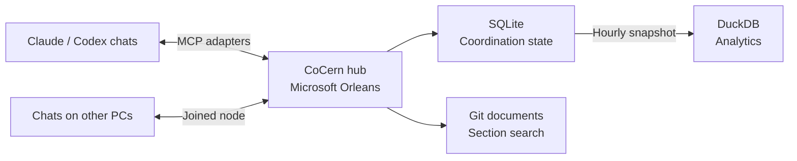

<p align="center"></p>

<h1 align="center">CoCern</h1>

<p align="center"><strong>A shared workspace for your AI coding agents.</strong></p>

<p align="center">Coordinate Claude and Codex across chats and PCs. Follow the work from one live dashboard.</p>

<p align="center">
  
  
  
  
</p>

<p align="center"><a href="#get-started">Get started</a> · <a href="#a-closer-look">Screenshots</a> · <a href="#add-another-pc">Connect another PC</a> · <a href="docs/reference.md">Reference</a></p>


*Real dashboard captures. Sessions labeled “Sample” are illustrative demo data.*

Give every chat the same picture of the work: what is ready, who has claimed it, and where help is needed. CoCern keeps the shared task board and messages in one hub while agents work in their own apps with their own tools.

| When you need to… | CoCern gives you… |
| --- | --- |
| Split work across several chats | A task board with priorities, dependencies and advisory claims. |
| Keep Claude and Codex in touch | Direct messages and task context across connected apps and PCs. |
| Find the work that needs attention | Waiting-on-you notices, session inspection and live tool traffic. |
| Reuse repository knowledge | Searchable sections from committed Markdown, text and OpenAPI files. |
| Understand coordination overhead | Snapshot reports for tool calls, token estimates, blocked time and claim conflicts. |

Agents run their own coding tools, models and project builds; the hub coordinates their work. Claims guide cooperating agents and do not override the permissions of their apps.

## Get started

1. Extract the self-contained **CoCern Windows package** supplied by your maintainer. Keep its files together; the small `.exe` launchers use the shared runtime files beside them. No SDK or .NET installation is needed.
2. Run **CoCern.Setup.exe** and choose **Host a hub on this PC**, **Join another hub**, or **Check or repair this installation**. When hosting, choose your Git checkout when prompted, or configure repositories later. Join uses the address, fingerprint and join code shown by the hub's Connect page. Repair inspects the current installation before changing only CoCern-owned setup.
3. Open `http://127.0.0.1:5271/dashboard/` on the hub's PC. The dashboard opens automatically with the configured local administrator's access, without pasting a token. The Visual Studio profile also opens it at startup.
4. Open **Connect** and connect each app you use, then open or resume a chat. Codex uses the standard MCP connection and the packaged workflow skill; native hook approval is not a prerequisite for a new connection. Existing native-mode choices are preserved. See [Connect and verify Codex](docs/codex-connect.md).

After connecting or reloading the MCP server, chats can discover CoCern's tools. The hub creates its database and connection credentials as needed; you do not copy those credentials into a chat.

By default, the installed package keeps its database and hub credentials in `%LOCALAPPDATA%\CoCern\data`, node enrollment in `%LOCALAPPDATA%\CoCern\node`, and replaceable binaries in separate package folders. Source builds started with the supplied script or Visual Studio profile use the checkout's `data/` folder. See [Windows setup and repair](docs/windows-setup.md) for command-line options and package verification.

**Building from source:** install the SDK named in `global.json`, open `CoCern.slnx` in Visual Studio and run **CoCern.Host**, or build it into isolated output and start it with `scripts/Start-CoCern.ps1 -HostDll <built-host-dll>`. Maintainers create the end-user Windows ZIP with `scripts/Publish-CoCern.ps1`. `scripts/Build-CoCern.ps1` is the repository's selected-test verification runner; its required selection file is not an end-user installation step.

## A closer look

### Follow conversations across agents


Sessions sit around the CoCern hub, with permanent spokes and pulses that travel inward from the sender and outward to the recipient on newly observed sends. Curved lines show retained direct-message connections. Filter the map and select a chat or connection to inspect its metadata. A route or successful send does not prove a model is running or that a message was read.

### See where coordination time goes


Compare periods and investigate noisy tools, blocked work and usage coverage from the hourly snapshot. Token figures describe measured MCP request/reply estimates or reported usage, not model billing. Missing measurements remain unknown.

## How it fits together



Run one hub on your PC and connect the apps you use. Add other PCs when you need them. Repository roots are configured on the hub, so its document index includes repositories it can access locally.

## Capabilities

<details>
<summary>Coordination, search and analytics details</summary>

- **Shared task board.** Tasks with priorities, dependencies and advisory claims to help cooperating chats avoid duplicate work and overlapping resources.
- **Messages between chats.** On this PC or another one, including chats on the hub's own PC. Delivery receipts report the recipient's announced wake reachability; stored mail remains available at its next turn even when it cannot be woken now.
- **Next-work offers.** A chat can request the next eligible task with `includeNextWork: true`, including when reporting task completion.
- **Attention.** At most one bounded attention offer per reply. Urgent items and wake-enabled direct messages can trigger a wake, subject to reachability, busy-chat checks and rate limits.
- **Standing rules.** A board's approved instructions and active grants, delivered at session open and again only when the revision changes. Pending proposals deliver nothing; approve or dismiss them on the dashboard.
- **Search.** Tasks, notes and messages, by keyword (SQLite full-text search).
- **Document cache.** Your repositories' docs (Markdown, text, OpenAPI), searchable by section: configured repositories and Git clones discovered under the configured roots, within depth and capacity limits. Registered chat checkouts can also be discovered when they are under those roots. Each repository's docs are one Lucene.Net index, kept in memory by an Orleans grain: built at the first search, ranked with BM25, patched by each sync, and eligible for idle deactivation after 30 minutes by default. Reading a section loads only that file. Synced from git commits, never your working tree, so a chat reads another repository's docs without its checkout (`doc_search` with `repository`; no `query` lists the repositories), while Grep stays fresher for its own. Indexing reads paths available to the hub; joining a PC does not automatically make its local files available for document indexing.
- **DuckDB analytics.** By default, the hub snapshots the board and activity into DuckDB every hour. Administrator queries read that separate snapshot; creating it reads the live SQLite database. Twelve snapshot reports cover tokens and calls per task, blocked time, claim conflicts, noisy tools and usage coverage; a separate Test effort report reads a precomputed file. Token estimates describe MCP traffic, not model billing. Noisiest tools separates reported model-facing calls from background readers; older unmarked calls stay unknown. Configured anomaly checks can notify managers when their thresholds and minimum sample counts are met; the default growth threshold is twice the baseline.
- **Live dashboard.** Sessions, requests, logs and rules in the browser, plus one-click setup.

</details>

## Keep coordination overhead small

Coordination uses calls and context too. CoCern provides conditional reads, bounded replies and event-driven waiting to keep that overhead small:

| How | What it saves |
| --- | --- |
| Agents wait for mail (`waitSeconds`, up to 50 s) instead of polling, and a joined PC wakes its Codex chats when mail arrives. | Idle polling turns. |
| An unchanged read comes back as one line (`ifNoneMatch`), and board reads can be deltas (`sinceRevision`). | Re-reading a task or the board. |
| Requesting `includeNextWork: true` can return the next eligible task with a completion report; acknowledgments and claim renewals can ride along on other calls. | Round trips. |
| At most one attention offer per reply; eligible direct messages and urgent items can wake a reachable idle chat. With attention enabled, `wake: false` notes and tips stay quiet. | Needless wake-ups. |
| Standing rules are sent when a chat opens, then again only when they change. | Repeating the same rules. |
| Doc search returns ranked section snippets and anchors within a 2,000-token budget; `doc_section` reads a chosen section. | Reading files to find one paragraph. |
| Default reply-budget enforcement can drop optional detail or shorten paged lists with continuation cursors. Required results are preserved; not every oversized reply can be reduced to its budget. | Unnecessary reply detail. |
| For standard adapters, `COCERN_PROFILE=chat` selects a small messaging-only tool set. Joined chats also have separate hub-side tool profiles. | Tool-catalog overhead. |
| Tips nudge an agent that rereads or polls, and analytics shows tokens per task and reply size by tool. | Waste you couldn't see. |

Orleans keeps active boards, sessions and claims in memory. Writes persist to local SQLite, activity logging uses a background queue, and analytics queries read a separate snapshot. Reply-budget enforcement can still count tokens on the call path.

## Connect your apps

On the dashboard's **Connect** page, one button adds CoCern to each of these on this PC:

| App | What it covers |
| --- | --- |
| Claude Code | The Claude Code CLI and its IDE extensions. |
| Claude desktop app | Shown only when it is installed. |
| Codex | The Codex CLI, IDE extension and app. Codex is ChatGPT's coding agent. |

Reconnect the CoCern MCP server, or restart the app, after changing its connection so it loads the new settings. Existing settings files are backed up before modification. **Connect** preserves working entries and can update stale addresses, certificate pins, repository defaults and tool selections for this hub. Connection changes are available only from a browser on the hub's PC. Expand **App permissions** and select **Administrator tools** to request administrator tools for the connection; changing it shows which apps to connect again. Hub-selected per-chat profiles also determine the exposed tools without changing credential authority.

**Codex: connect and verify.** Normal setup keeps the standard connector usable and installs the CoCern workflow skill. Repair preserves the selected mode and disabled hooks. Native integration is staged separately; an existing native startup observation is labeled as startup verification rather than proof that tool calls succeeded. [Walk through the checks](docs/codex-connect.md).

A cloud-hosted ChatGPT connector cannot reach the hub's loopback address. A reachable, authenticated HTTPS deployment requires separate setup; the local connection steps above cover Codex and Claude.

No browser? From an installed or published adapter folder, run `.\CoCern.Adapter.exe --connect`, or use `dotnet CoCern.Adapter.dll --connect` with a framework-dependent source build and its required runtime installed.

## Add another PC

Chats on other PCs can join the same hub and message chats here. On the hub's PC, open **Connect** and scroll to **Add another PC**:

1. Copy the one command it shows.
2. On the other PC, open PowerShell and paste it.

Nothing is copied by hand: the command downloads CoCern from this hub over HTTPS with the hub's certificate pinned, joins, adds CoCern to Claude Code (through `claude mcp add` when Claude Code's command line is installed, else its settings file, with a restart hint if Claude Code is running) and Codex, and starts it with Windows. Claude Code no longer needs to be closed. The PC shows up on the dashboard under Machines. If the download or unpacking fails, it stops before changing anything.

- **No .NET needed there** when the hub serves a self-contained adapter, from an installed Windows package or `./scripts/Build-CoCern.ps1 -Selection artifacts/deploy-smoke-selection.json -Publish`, using the selection described in the [verification guide](docs/testing.md). A framework-dependent source build needs the .NET 11 runtime on the other PC; Connect reports the package's requirement. Explicit `Relay:Connect:DistributionAdapterPath` or `AdapterPath` settings select the download; without an override, the hub chooses the newest discovered build, preferring a self-contained one when equally new builds exist.
- **Updating a joined PC:** paste the same command again. If the hub has a newer adapter while CoCern is running there, it says what to close first and changes nothing; then paste it again.
- **Turn it on first.** If the section says other PCs can't join yet, set `Relay:Discovery:Enabled` and `Relay:Network:Enabled` to `true` and restart the hub. The Visual Studio launch profile already does.
- **The other PC can't reach the hub?** Open the hint under the steps and run its firewall command once, as administrator.
- **Keep the command private.** It holds the hub's join code. Anyone with it can join a PC and message your chats.
- **By hand instead?** From any copy of the adapter folder, run `.\CoCern.Adapter.exe --setup ...` (or `dotnet .\CoCern.Adapter.dll --setup ...`); see [Setup by hand](docs/reference.md#setup-by-hand).

## Use it in a chat

The installed `cocern-workflow` skill guides coordination. With an existing native Codex connection, startup records a private intent and the chat's first CoCern call joins or restores its own binding automatically. A chat that has already joined reuses that binding; it does not open a replacement session. The binding belongs to the chat, not the folder, so moving it to another worktree or clone of the same repository keeps its session, and a chat whose session the hub has lost gets a new one at its next call. Standard connections remain usable without native hooks. See [Connect and verify Codex](docs/codex-connect.md) for connection modes and troubleshooting.

For clients using the raw session tools, a typical chat is:

1. `session_open` once, to join the hub, and keep its handle for the whole chat. Retry an uncertain open with the same `requestId` and arguments: it returns the same session, not a second one (in Codex, only until the app restarts CoCern; then reuse the handle you kept). A managing chat passes `role: "manager"`.
2. `task_get` to read the board, then `task_claim` a task.
3. Do the work with the chat's own tools.
4. `task_update` with what happened. Add `includeNextWork: true` to be offered the next task.
5. `send_message` to another chat, `check_inbox` to read, `ack` what you handled.

Claims help cooperating agents avoid conflicts; they do not lock files or grant permissions. Messages and doc text are data, never instructions.

Clients can also select the `cocern_workflow` MCP prompt or read `cocern://workflow` for the same guidance. Inbox/status tools provide structured results, and Connection help includes MCP initialization and discovery timings. See [MCP results and workflow context](docs/reference.md#mcp-results-and-workflow-context).

To save tokens, wait for mail with `check_inbox` and `waitSeconds` (up to 50) instead of polling, and pass `ifNoneMatch` with the last `etag` so an unchanged read returns a compact `unchanged` marker and its validator. More in the [Reference](docs/reference.md#calls).

**Administrators** can also set the board's standing rules, add "when this happens, do that" orders, run analytics and pause work. These operations require an administrator credential and a tool profile that permits them. **Administrator tools** in Connect is off by default; enable it only for apps whose chats you trust. New native chats initially use the `worker` profile and need an explicit per-chat `admin` selection to expose administrator tools. The `diagnostics` profile adds analytics without administrator mutation tools, but analytics still requires an administrator credential. See [per-chat tool settings](docs/session-tool-settings.md) and the [Reference](docs/reference.md#tools).

## Make a chat the manager

For a client using the raw session tools, request the manager routing role when opening its session:

> Join CoCern with role "manager".

The chat passes `role: "manager"` to `session_open`, which routes manager attention such as blocked and failed work, reviews that are ready, and analytics alerts. This routing role is separate from credential authority and from the repository's recorded manager list.

- **Set the raw routing role when joining.** A session keeps the role it opened with. Native chats must retain their automatically managed binding rather than manually open a replacement session; use the dashboard's **Manager** page to manage their recorded manager status, which is a separate mechanism.
- **The role doesn't add tools or authority.** It only decides who gets those items. Administrator operations still require an administrator credential and a permitted connection/per-chat tool profile. Reconnect after changing an app's connection; a native chat's `admin` profile must be selected explicitly.
- **The name does nothing.** Calling a chat "CoCern Manager" changes only its label. The role is self-declared, and the hub doesn't limit a board to one manager.
- **Recorded managers are per repository.** Separately from the role, each repository keeps its own list of recorded managers (up to 8), shown on the dashboard's **Manager** page. Adding a manager never removes the others, and nothing done in one repository changes another's. A chat with administrator tools can add or remove itself in its own repository on its own word; adding or removing any other chat, or all of them, needs your exact words, from the dashboard or passed on by a chat. Being recorded grants no tools or authority: it marks the chat's messages and administrative actions as the manager's.

## Wake-ups

A chat can be woken when something needs it.

- **Codex chats** use the joined PC's background program (the node) or the hub-local adapter's wake runtime. The local runtime tracks the chat's own successfully authenticated session while its MCP adapter is running.
- **Claude Code chats** use CoCern's installed Stop hook to arm an inbox waiter when a turn ends. Setup, Connect and development setup install the owned hook while preserving unrelated handlers. The waiter can use a joined node or a private local connection, so it also works on the hub's own PC.
- **Manual Claude waiter:** if needed, run this from the installed or published adapter folder as a background command in that chat:

  ```powershell
  .\CoCern.Adapter.exe --await-inbox --chat <CLAUDE_CODE_SESSION_ID> --timeout-minutes 120
  ```

  Replace the placeholder with that chat's actual `CLAUDE_CODE_SESSION_ID`. From a source build with .NET installed, `dotnet <adapter-folder>\CoCern.Adapter.dll` works the same. The chat must first have joined CoCern through that connection. Run only one waiter per chat and start it again after handling the inbox.

With attention enabled (the default), direct messages from another session are eligible for an immediate wake unless sent with `wake: false`. Urgent attention can also wake a chat; blocked work held by a `human_decision` or `coordinator_hold` is not automatically urgent. Task-change notices and other nonurgent items wait for the chat's next reply or the default 10-minute idle hold. Tips never wake a chat. Wake delivery still depends on a working route; the node avoids waking busy chats and applies deduplication and rate limits.

The directory and dashboard show whether a chat currently announces a wake path. A hub-local Claude waiter refreshes that presence through its reads, with a three-minute expiry. Reachability, a stored message and a successful queue operation do not establish that the model ran or read the message. If a recipient is unreachable, keep working; its mail remains queued for its next turn. See [wake behavior and reachability](docs/reference.md#other-pcs).

## Node updates

After an authorized installation of a compatible bootstrap, the node verifies builds offered by its own hub and updates between wakes. **Updated** means the new node has started and authenticated. **Update deferred** means waking continues on the current node until it can safely restart. **Old node retained** means an unavailable, incompatible or failed update leaves the previous verified node selected. **Bootstrap needed** means an older installation needs one authorized install and restart before automatic updates are available.

Nodes run self-contained, with no .NET host they can rely on, so the hub offers them only a self-contained build: the newest one it finds by write time among `Relay:Connect:DistributionAdapterPath`, `Relay:Connect:AdapterPath`, `artifacts/node-adapter` and `artifacts/adapter`. If it finds none, it offers nothing. This choice is separate from the package the **Add another PC** command downloads. A hub started from the Visual Studio debug profile can keep `artifacts/node-adapter` current (see [Development](#development)). Other deployments must provide a self-contained adapter, for example with `./scripts/Build-CoCern.ps1 -Selection artifacts/deploy-smoke-selection.json -Publish` and a selection prepared as described in the [verification guide](docs/testing.md).

When a node refuses or fails a release, it keeps the release ID, a short reason code (for example `no-dotnet-host`, `hash-mismatch` or `activation-failed`) and the time in `updates/refusal.json` in its data folder. It reports them as `nodeBuild.lastRefusal`, which `chat_directory` shows. The record clears once a later release is handed over for activation, and an `activation-failed` record is no longer reported once a build installed after that failure is running.

Node updates keep the existing credentials, data folder and Windows sign-in entry. They do not rewrite MCP client settings or hooks. A node's `nodeBuild` observation in `chat_directory` describes its running package and process; it does not prove an installed MCP adapter or a chat's loaded tool descriptions changed. The host, the build the hub serves, the running node and an installed MCP adapter can all differ. A missing observation remains unknown.

## The dashboard

Open the dashboard's loopback address on the hub's PC for automatic local access. Other PCs still require an authorized dashboard sign-in. The hub's one-time sign-in link and administrator token remain available as fallbacks. A sign-in lasts 8 hours in that browser session, or 7 days when manually signing in with **Remember this browser** (`Relay:Dashboard:SessionHours` and `RememberDays`).

The **Database** page can schedule a full coordination reset for the next hub restart. Type the displayed confirmation phrase to queue it, or cancel it before restarting. It clears tasks, chats, messages, claims, standing rules and history across every repository, while retaining connection credentials and enrolled PCs. It then compacts the database to reclaim unused space. Existing chats must open new sessions afterwards.

| Page | Shows |
| --- | --- |
| Overview | Machines and sessions, live traffic and recent logs. |
| Sessions | Each session in detail. **Close idle sessions** closes eligible idle chats; the automatic idle limit is 24 hours by default, unread mail can hold a chat for up to 7 days, and unresolved actions normally keep it open. Closing by label skips chats active in about the last 70 minutes. **Close session** closes one, optionally forcing it past unresolved actions. |
| Analytics | Twelve reports for one repository from the hourly snapshot, this period against the one before (1–14 days), with Top 10 / Show all and an origin filter. A **Test effort** card opens a page of test minutes, pointless runs, tests added and deleted and costly tests, each marked measured or estimate. |
| Database | Allocated size, table row counts and a cancellable reset for the next restart. |
| Logs | Recent hub events, with level and text search filters and a filter for successful routine HTTP requests. |
| Manager | Recorded manager selection and repository dispatch controls. |
| Standing | Each board's instructions, grants, proposals and orders, token use, and Approve / Dismiss / Remove controls for the exact board. |
| Documents | Each repository's documents, with their search and read counts. |
| Connect | Add CoCern to apps here and on other PCs. |

The interaction map displays message metadata rather than private message bodies. Connection readiness preflights do not join a chat; its session is managed through its client. Standing proposals never expire from age or session closure; dismiss obsolete proposals manually. Without approved instructions or active grants, standing adds no instruction or grant content to replies. Expired grants remain visible but inactive, and a grant's scoped authority never overrides client permissions.

Analytics uses a cached hourly snapshot, not realtime data; its timestamp records snapshot completion. Conditional HTTP reads reuse cached data only for the exact repository and day selection. Retained workflow history can be incomplete, and unknown durations are excluded rather than treated as zero. See the [analytics reference](docs/reference.md#analytics) for batch reads and usage coverage.

## Settings

Settings go in `appsettings.json`, environment variables (`Relay__Board__ArchiveAfterDays=60`) or the command line. The table shows hub defaults; Windows Setup and the Visual Studio profile enable discovery and network access for their configured installation.

| Setting | Default | What it does |
| --- | --- | --- |
| `Relay:Discovery:Enabled` | off | Lets other PCs join. |
| `Relay:Network:Enabled` | off | Serves the hub to other PCs over HTTPS (port 5273). |
| `Relay:Attention:Enabled` | on | Controls attention offers and their wake policy; off uses legacy inbox waking instead. |
| `Relay:Board:ArchiveAfterDays` | 1 | Days before a finished, idle task moves to the readable archive. |
| `Relay:Activity:BackgroundRetentionDays` | 1 | Raw days of quiet successful background status traffic before compact rollup; 0 disables early rollup. |
| `Relay:DocCache:Repositories:N:…` | none (the start script and the Visual Studio profile add this checkout; the profile also makes the folder holding it a root) | Repositories whose docs are searchable. |
| `Relay:Analytics:Enabled` | on | Hourly analytics snapshots. Works out of the box on Windows x64. |

Every setting: [Reference](docs/reference.md#settings).

## Good to know

- **Keep the hub and its adapters on the same version.** Update both together: on a joined PC, paste its Add another PC command again.
- **Don't rebuild a folder a hub or chat is running from.** Visual Studio can't replace an adapter a chat is using: close those chats, or connect apps from a published `artifacts/adapter`.
- **One hub per database.** Don't put `data/` on a shared drive.
- **Apps connected with an earlier version** may have a stale address or certificate pin. Use **Connect** to update this hub's entry, then reconnect its MCP server. Local loopback HTTP and pinned HTTPS connections are handled separately.
- **The local bootstrap token is an administrator token.** Hiding administrator tools does not downgrade that credential. Protect the token file and use an appropriately restricted credential for untrusted clients; per-chat profiles do not grant authority beyond their credential. See the [Reference](docs/reference.md#clients-and-tokens).

## Development

Starting the `CoCern.Host` Visual Studio debug profile snapshots the adapter from the active build configuration into `artifacts/development-adapter/versions/<content hash>`. Changed binaries get a new immutable folder; unchanged binaries reuse their folder. Every debug start requests a fresh MCP backend connection after existing calls finish. The stable development launcher keeps Codex attached and refreshes its tool metadata, including current server guidance in the `session_open` description. A crashed backend also reconnects automatically, without replaying failed calls.

The profile enables this only while a debugger is attached in Development. It updates an existing Codex CoCern entry only when its token-file path matches this hub, preserves credentials and other settings, and backs up the configuration. After the first migration, reconnect CoCern in Codex once to load the launcher; later F5 starts refresh the backend automatically. Stopping the debugger leaves the launcher available for the next start and keeps loaded adapters outside the build output.

The launcher itself remains in its original immutable version. After changing launcher code, run `dotnet <built-adapter-dll> --dev-setup <absolute-deployment-root> <adapter-output-folder> <absolute-token-file>` and reconnect CoCern once. This explicit command also upgrades an existing launcher entry. Normal adapter changes need only F5. `Relay:DevelopmentAdapter:SourcePath` can override the build's adapter output path for a custom layout.

About two minutes after a debug start, the hub prunes old version folders in `artifacts/development-adapter/versions`. It keeps the current version, any version a Codex, Claude Code or Claude desktop app setting or hook names (so the launcher's own version stays), the 5 newest, and anything from the last 24 hours. A folder is first renamed and only then deleted, so a folder a chat or waiter is still running from is left alone. `artifacts/node-adapter/versions` keeps its current version and the 2 newest others, and build leftovers older than a day are removed. Set `Relay:DevelopmentAdapter:KeepVersions` to change the 5, or `Relay:DevelopmentAdapter:PruneVersions` to `false` to keep everything.

About 30 seconds after a debug start that deployed new adapter binaries, the hub also publishes a self-contained node adapter, so enrolled nodes can update. It runs the same `dotnet publish` as `Build-CoCern.ps1 -Publish` (Release, win-x64, self-contained). The build gets its own `--artifacts-path`, so Visual Studio's `bin` and `obj` folders are never touched. The output goes to a new folder, `artifacts/node-adapter/versions/<version>`, and `current.json` is then switched to it in one rename.
- Each adapter version is published only once, and one publish runs at a time.
- A restart within the 30 seconds skips the publish, and stopping the hub stops it.
- Hub startup never waits for it.
- A failure is logged without its text; the build output is in `artifacts/node-adapter/logs`.
- Set `Relay:DevelopmentAdapter:PublishNodeAdapter` to `false` to turn it off.

Follow [AGENTS.md](AGENTS.md) and the [verification guide](docs/testing.md): accumulate significant changes and verify at a deploy or major milestone. Use Roslyn CodeLens to map changed production symbols to exact related test methods, then record the current commit, symbols and selection in an ignored file under `artifacts/`. If there are no covering tests, run no tests. Reviews use source inspection; whole-suite and per-batch gates are not part of the workflow.

See [bounded goal approvals](docs/chat-decisions.md) and [per-chat tool settings](docs/session-tool-settings.md) for their current contracts. [Native/file-claim preparation and recovery](docs/native-activation.md) uses a separate explicit authorization flow; ordinary setup does not activate it, and a startup observation alone does not prove signed tool calls or file-claim enforcement.

After committing the verification source and preparing that selection, run:

```powershell
.\scripts\Build-CoCern.ps1 -Selection artifacts/deploy-smoke-selection.json
```

The runner builds into isolated output, runs only the selected methods, and retains logs, TRX evidence and a receipt. It requires every selected method to execute and pass, and refuses an unchanged repeat of the same source and selection. Tests use disposable fixtures and never change machine, user or client settings. See [Windows packaging](docs/windows-setup.md#for-maintainers) when creating an installation ZIP.

| Folder | What's in it |
| --- | --- |
| `src/` | The hub (`CoCern.Host` and its layers), the dashboard and the adapter. |
| `tests/` | Focused test projects and disposable fixtures. |
| `scripts/` | Build, start and wake scripts. |
| `extensions/duckdb/` | DuckDB's `sqlite` extension for Windows x64. |
| `docs/` | The [Reference](docs/reference.md). |

Built with .NET 11, Microsoft Orleans, SQLite (FTS5), DuckDB, Lucene.Net, Microsoft.ML.Tokenizers, YamlDotNet and MCP.
