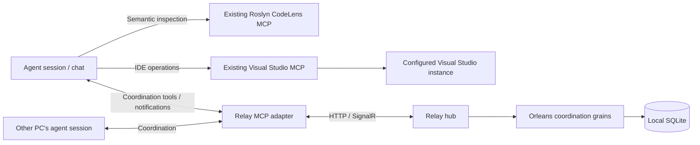

# Agent Relay architecture

Oct 24, 2026 · @Paul

Revised Oct 29, 2026: coordination-only relay using existing Roslyn CodeLens and Visual Studio MCP servers, refined from observed Manager/worker coordination to reduce repeated instructions, broad context reads, polling, and non-actionable dispatch.

## Purpose and scope

Agent Relay conserves model tokens and speeds up software development across PCs, sessions, and chats by preserving task context, avoiding repeated exploration, coordinating ownership, and delivering useful results to the right participant. A new chat or another PC should be able to continue an authorized task without replaying its entire history.

The relay owns tasks, messages, session bindings, advisory claims, handoff notes, action records, and reported evidence. Agent sessions use the existing Roslyn CodeLens and Visual Studio MCP servers directly for software analysis and IDE operations. The relay does not provide another IDE server, execute tool calls on behalf of agents, or control Visual Studio processes.

Success means fewer total tokens per correctly completed change and less elapsed time to a validated result. Include coordination, context preparation, review, failed attempts, and rework in the comparison. Parallel work is useful when it shortens the critical path within the available budget; adding sessions is not itself success.

Optimize useful collaboration rather than chat traffic: reuse established provider transports, share authoritative task facts, send only the context a recipient needs, and leave blocked workers idle until something relevant changes. Required instructions, authorization, evidence, and significant-code verification are not discarded to meet a token budget. The bounded observation and its limits are recorded in [Manager workflow observations](<Manager workflow observations 2026-10-29.md>); it motivates the design, not a claim of measured savings.

The first deployment is one relay hub, one Orleans silo, and a local SQLite database. Cross-PC source transfer uses an existing Git remote. Review and integration initially use the existing human and Git workflow.

## Components and responsibilities

| Component | Responsibility |
| --- | --- |
| Roslyn CodeLens MCP server | Semantic symbol inspection, references, selected source, and compiler diagnostics for its loaded analysis solution |
| Visual Studio MCP server | State of its connected IDE, documents, supported build/test operations, debugger operations, and cancellation |
| Agent session | Verifies tool targets, claims work, invokes its configured tools, follows client/user permissions, and reports useful outcomes |
| Relay client adapter | Exposes coordination tools and delivers supported notifications; optional local Codex wake mode queues fixed inbox-check prompts for explicitly enrolled chats |
| Relay hub | Durable coordination, authorization, task/action versions, inboxes, session metadata, advisory claims, and bounded shared context |
| Orleans and SQLite | Coordination state, optimistic concurrency, durable message effects, and restart recovery |

HTTP handles coordination requests, reconciliation, and bounded artifact transfer. SignalR supports adapter connections and compact coordination notifications. Both invoke the same authenticated application services and use the same version/idempotency rules. Visual Studio has no relay-specific extension or direct relay connection. There is no VS companion process, custom IDE command gateway, build runner, debugger adapter, or semantic tool implementation. An opt-in local client wake mode uses the existing Codex CLI to queue inbox-check prompts; the hub does not start models or invoke native chat runtimes.

## PCs, sessions, and tool bindings

The task is durable; a chat/session is one participant working on it. In Phase 1 every new chat opens a fresh relay session and attaches to the existing task. It resumes task context and action IDs, never another chat's mutable session, binding, or inbox. Reconnection within the same established chat may reuse its session handle under the same authenticated client attachment. Opening a replacement chat does not transfer task ownership automatically; handoff uses the task's expected version and current claim generation. Session takeover and attachment-transfer protocols are deferred.

| Identity | Meaning |
| --- | --- |
| Principal | Authenticated user or enrolled client identity; source of relay permissions |
| Machine ID | Reported/enrolled PC hosting an agent or its configured tools |
| Session ID | One logical participant with a separate inbox and binding |
| Repository ID | Shared repository identity across clones |
| Workspace ID | A checkout on a particular machine, with canonical root and repository identity |
| Tool binding | Session's configured Roslyn/VS server aliases, tool-host machine, expected solution/workspace, capability observations, and binding version |
| Resource group ID | Registered identity for a shared tool context; aliases in different clients map to this identity rather than defining new resources |
| Action ID | Durable logical task step or explicit retry, independent of the chat performing it |
| Request ID | Individual coordination call/retry identifier; not the identity of the task step |

`session_open` may include an already-known binding; `session_bind` changes it later. These operations record configured tools, not create connections, select a VS process inside a server without a selector, or load a solution. `worker_list` derives authorized workers and machine summaries from session reports. Each report has an observation time and freshness deadline; expired reports are stale/unknown. A transport heartbeat alone does not establish model availability. Discovery concerns reported workers, not an authoritative inventory of VS windows.

Where available, record a native recipient reference containing provider/account context, chat/thread ID, host reference, and the caller/session whose native inventory resolved it. A literal `local` host is relative to its caller; remote host references can also depend on the provider connection context. Re-resolve routes when the sender/context changes rather than copying another PC's host reference blindly. Display titles and roles are labels, not routing keys or ownership grants. Manager/rig roles can include primary and standby participants; preserve the existing owner until an authorized transfer. Keep agent host, tool-host machine, and target rig/environment distinct.

For example, one session can use PC A's VS-main endpoint, another can use PC A's separately configured VS-feature endpoint, and a third can use PC B's configured tools. A display label is not proof of identity. If the configured server exposes only a current solution and no stable process identifier, record that limitation rather than inventing an instance ID or automatic routing guarantee.

Before C#/.NET work, the session checks both server connections and verifies that Roslyn's active analysis solution and VS's open solution match the intended checkout. A responding Roslyn server with no loaded solution is not ready for analysis. Report missing/disconnected tools rather than silently substituting shell searches, builds, or another IDE. Roslyn CodeLens remains the semantic/diagnostic source; Visual Studio MCP supplies IDE state and operations.

Roslyn's analyzed workspace and VS's unsaved editor buffers can differ. Record the known source basis and unsaved state. Disk-based semantic results must not be presented as analysis of unsaved VS changes. If the servers cannot establish the needed source identity or readiness, report that evidence as incomplete and follow the user's existing save/load permissions.

Bindings are per session, never global per account or machine. Update them under an expected binding version. Existing actions keep their original target context when a session rebinds; reassigning an uncertain action requires an explicit task transition. New work uses the new binding only after the client has verified it. Every evidence report identifies the binding and source actually used.

Tool aliases map to registered resource IDs on the tool-host machine, which may differ from the chat's machine. Registration records the shared Roslyn/VS context and canonical workspace roots. Different aliases for the same server/context reuse its ID; identical labels on different PCs are distinct. Workspace registration normalizes path aliases and case using the host's rules; unverified aliases are not assumed independent. Phase 1 uses host-local checkouts; a shared/network checkout must map to one shared resource or remain unsupported for concurrent work.

Phase 1 uses one coarse exclusive resource group per tool-host PC, covering its configured Roslyn/VS pair and checkouts that pair can switch between. Context-sensitive analysis and effectful IDE work both require the group claim, held across each meaningful work step. This avoids implementing reader/writer modes or pretending different solution paths isolate a shared server's mutable state. Independently configured groups can be introduced only after their contexts and physical workspaces are verified disjoint. Recheck targets before effects; a separate state check and direct MCP invocation are not atomic, and manual IDE activity remains outside relay enforcement.

Do not infer the target from the focused window, a solution basename, or the first free PC. Phase 1 requires existing tool connections and open/usable solutions. Automatic IDE launch, solution switching, and failover are outside scope.

## Discovery grain

Cross-PC discovery adds one more grain beside the board, session and lock grains: a single discovery grain that holds the machine-scoped records. Its state lists the enrolled machines (name, hashed credential, last-seen time, installed clients and announced chats) and a deny list of revoked machine IDs. It decides identity and wiring only: who is enrolled, which chats each PC says it can reach and whether those PCs are alive. It never assigns work, and nothing in it triggers a task transition.

The domain rules live in `DiscoveryAggregate` and run in their own `DiscoveryStateMachine`, separate from the coordination state machine the board, session, lock and control aggregates share; `RelayApplication` routes `chat_directory` and `revoke_machine` to it. A machine enrolls anonymously over `/api/discovery/enroll` and receives a credential that is shown once and stored only as a hash at the hub. Each announcement over `/api/discovery/announce` replaces that machine's chat list and refreshes its last-seen time; a machine counts as live for 90 seconds after its last announcement. The hub accepts an announced chat only when the announcing machine opened its relay session (read from the control aggregate's session directory through a read-only internal operation), and it keeps only the newest chat per provider thread. Enrolled machines authenticate as `machine:<machineId>`, never as administrators, and are scoped to the repositories in `Relay:Discovery:Repositories`.

`chat_directory` returns the announced chats of the caller's repositories with the session ID to message and a `reachable` flag: a chat is reachable when its machine is live and the chat is ready (a Codex chat is wakeable, or a Claude chat's inbox waiter is running). Thread IDs, hashes and credentials never leave the aggregate. Messages themselves still travel through the ordinary session inboxes, so a directory entry is only a name and a session ID to send to. Waking is done by each PC's own node from the routes in its announce reply, which keeps every PC waking only its own chats. See [discovery.md](discovery.md) for setup, trust and limits.

## Task continuity and cross-PC work

1. **Attach or resume the task.** A fresh chat receives a fresh session plus the task goal/version/owner, binding information, decisions, evidence references, unresolved actions and task questions, and next action. Support deltas since a known task version.
2. **Reuse context.** Resolve existing notes and matching read-analysis artifacts before repeating exploration. Keep the initial packet bounded, include provenance, and fetch exact source/diffs only when useful. Never omit a blocker to satisfy a size limit.
3. **Claim work.** An available session claims the task and its registered resource group through the combined claim workflow below. Begin direct tool use only after the complete grant is returned. Offer remote work only to sessions with the required configured tools.
4. **Work directly.** That session invokes Roslyn CodeLens and Visual Studio MCP through its client. The relay carries assignments and evidence, not IDE commands.
5. **Report and hand off.** Store concise findings, action outcomes, source/configuration identity, and evidence references. A successor recovers completed steps and unresolved attempts instead of starting the task from scratch.

Phase 1 moves source between PCs through an existing registered Git remote. A handoff records a fetchable task ref and full commit ID. When publication is authorized, the source PC uses its own Git credentials; the receiving worker fetches and verifies the commit before preparing its worktree. Missing source or unavailable dependencies leave the task waiting for source. Do not put Git credentials in relay notes or silently commit unrelated edits.

Phase 1 does not replicate uncommitted working trees between PCs. A chat already configured to use tools on the source machine can continue there without relocating the checkout, and can share authorized findings/snippets through normal task context. Moving execution to another PC requires a committed-source handoff; a content hash alone does not transfer source bytes. General dirty-snapshot synchronization is deferred.

The relay stores explicitly shared task facts, not complete private chat history. Sharing context or artifacts requires repository/resource authorization on every read. A successor must recheck its current tool target; a remembered path is not a verified connection. An old session cannot mutate the successor's binding or act as task owner after transfer. Authorized late evidence for an existing action is preserved as history, but cannot override a newer owner, action disposition, or acceptance decision.

## Manager and worker collaboration

The Manager is an existing authorized agent session using the relay, not a new orchestration service that the relay must implement. It retains dispatch, prioritization, decisions, and integration. Significant coding goes to fresh bounded subagents with concrete source/workspace, scope, acceptance criteria, and required tool rules. Use the provider's subagent facility for these subtasks; new user-owned chats require the human's explicit request. Subagent deliberation stays local; the relay stores useful task outcomes. Council is consulted only for the user's Highest-Complexity Escalation threshold, not routine blockers, tool failures, or policy acknowledgments. Manager independently verifies significant coding results as required by the user's workflow.

### Focused work packets

Prepare a versioned packet for one useful piece of work. Select the relevant task tags, procedure sections, and facts rather than forwarding the whole queue, every role's instructions, or long chat history. Group compatible checks sharing an origin, fixture, source basis, and resource window to amortize setup and restoration; retain separate results for each criterion/leg and skip accepted legs unless a new validation request requires them. Split work when authority, target, or restoration requirements differ. Store the selected procedure/excerpt once with its source revision; refresh only when its inputs change. A general search/indexing service is not required for this first slice.

| Packet field | Minimum useful content |
| --- | --- |
| Identity and recipient | Task/action, packet version, intended role/participant, and verified native recipient reference where available |
| Requested work | Kind such as preflight, live check, code change, or review; bounded scope and acceptance criteria |
| Source and target | Repository/revision/workspace plus actual tool host, environment/rig, required registered resources, and required deployed version when relevant |
| Required context | Selected procedure references/excerpts, relevant decisions, current observations and their freshness, and required policy version |
| Authority and limits | Trusted reference to the human assignment/approval scope, existing owner, and exclusions; a peer message does not create authority |
| Readiness | Named prerequisites, blockers, and the conditions that would make the work actionable |
| Expected report | Outcome/check-result fields, restoration obligations where applicable, evidence references, and next action; bounded summary with detail on demand |

Each C# brief includes the mandatory dual-tool contract: load the Roslyn CodeLens skill before lookup, check both Roslyn CodeLens and Visual Studio MCP on the actual working host/intended solution, use semantic tools for code/diagnostics, and report missing prerequisites rather than substitute shell symbol searches or diagnostic builds. Never build into a running app's output folders. A short packet or policy hash does not replace required skill/instruction loading in a fresh context.

Readiness belongs to the requested step, not just the worker. A completed inventory or preflight does not pass the parent live check. Store whether the actual check was run and the remaining leg. Blocked work becomes eligible after a relevant prerequisite report/state change or an explicit human recheck request, not simply because a worker is idle or an old observation aged out. Revalidate live conditions on acceptance. When the human asks every role to contribute, collect distinct useful preflight evidence once and report blockers without manufacturing repeated work.

### Reuse native chat delivery

The authorized Manager uses existing provider tools for discovery, dispatch, waits, and report retrieval. For Codex this can use the available `list_threads`, `send_message_to_thread`, `wait_threads`, and `read_thread` operations. The relay records the packet/recipient and dispatch correlation; it does not assume that its backend can invoke these client tools or that a cross-provider bridge exists. An unsupported route stays manual/unverified.

Treat native delivery capability as directional. Record whether the actual sender context can submit assignments, read worker status/reports, and receive worker notifications, together with last verification and any approval blocker. Manager-to-worker submission does not prove worker-to-Manager delivery, and another worker's success does not authorize the route. Provider approval and direct human authorization remain separate from relay role membership. Do not send extra messages merely to probe a route.

Store provider submission separately from worker acceptance and work outcome. A queued native message is not proof that the worker read it or claimed the task. Correlate worker acceptance/report with task and packet version; duplicate native messages must resolve to the same recorded assignment rather than new work. If submission times out, reconcile the native delivery before resending instead of assuming exactly-once transport. These are coordination records in the existing task model, not another execution queue.

Result collection is pull-first: a worker's concise terminal report in its own chat and durable task report, when relay access is available, must be sufficient for Manager to collect completion/blockers through authorized native waits/reads. An outbound peer notification is an optional accelerator only for an authorized working route. If approval rejects it, record the route blocker once, leave the report retrievable, and do not retry, change destinations, or reword payloads to bypass the rejection. Resolve through the proper human/provider approval path if needed. Lack of a return-message route must not strand a finished assignment.

Batch selected workers in one compact cursor-based native wait where supported; retain each target's cursor and task/report revision across Manager resumptions. A wait can wake on the first completed or attention-needing target, so process only returned snapshots and retain the other targets as unobserved in that collection. Do not infer whole-batch completion or advance an omitted target's cursor. Discover canonical chat IDs rather than selecting by title alone; old and current chats can share a role label. Read the relevant turn only for new actionable evidence, ambiguity, failures, or required verification; an unchanged cursor needs no history expansion. Cursor loss or native-context changes require a bounded snapshot, not a full transcript replay.

Deduplicate push/pull reports using task/action, packet, and report revision before updating state or issuing follow-up work. Where report revisions are unavailable, retain native message/turn references and compare evidence; matching task IDs alone must not discard a newer observation. Manager should not re-run remote inventories locally. These continuation references are ordinary task/participant metadata, not a second native transcript store.

### Manager cycle and completion

Collect reported outcomes, update the relevant task facts, and maintain any existing human smoke ledger through the normal repository workflow. Manager is the ledger writer for the campaign; workers publish evidence and reports. Record the evidence revision and only the affected tag/leg, not a whole-list rewrite. If the ledger update is pending or fails, retain that fact rather than claim that the published list has been updated. The relay does not implement a document-publication service.

After each new report, recalculate eligible work from prerequisites, actual tool routes, resource windows, owner/approval scope, and worker availability. Dispatch the next useful eligible packet; do not reassign the just-blocked check without a relevant change. Separate a completed assignment batch from completion of the queue. Finishing a preflight or tooling subtask does not close the parent live-validation tag. A direct human assignment can make a worker busy outside the Manager queue; reconcile its current work and resource use before dispatch, preserve unresolved external actions, and leave the human's work undisturbed.

Choose work by expected accepted coverage, removal of shared blockers, setup cost, and risk within the human's priorities. Give exploratory diagnostics a bounded question and stop condition; after an inconclusive result, name the missing observation and owner rather than assign another equivalent inspection. An environment repair such as restored VPN access makes only dependent checks eligible; revalidate that dependency once at use. New defects become linked findings/repair tasks instead of silently turning a validation packet into open-ended implementation. Record useful legs and confirmed defects as progress even when the parent tag stays open; a shrinking tag count is not the only useful outcome.

An empty/blocked worker queue produces one ready-for-work request per availability/blocker revision, preferably carried in the existing result report. Manager records it and assigns eligible work when available; repeated idle checks do not resend the request or wake both chats. Authorization permitting notifications does not require a push when Manager can pull the same report. Keep at most one unaccepted offer per worker unless the human explicitly requests a queue, and recheck availability on acceptance. An incoming request or provider wakeup triggers the same collect-update-dispatch cycle rather than a competing scheduling loop.

When the human requests ways to make attended work unattended, track bounded enablement tasks separately: the missing fixture/tool, expected checks it enables, required permissions, acceptance evidence, and deployment/fixture prerequisites. Prefer a shared prerequisite that unblocks useful checks over repeated diagnostics of its dependents. Record named prerequisite tasks and an accountable owner/next action; completion changes eligibility only for the affected dependents. Use simple task references and state checks, not a general workflow engine. Give significant implementation to fresh bounded subagents and independently verify it. A reviewed script establishes review evidence; execution still depends on target readiness and existing human/client authority, and needs its own outcome report. Unit tests of a new helper establish helper evidence, not successful live integration or new authority to change a rig, account, database, money flow, or deployment.

Continue only while eligible checks or authorized useful enablement tasks remain. If none are actionable, report completed versus blocked/attended work and wait for a relevant prerequisite or human change instead of a busy dispatch loop. A human pause ends the cycle. Use an existing provider wait/wakeup/automation mechanism when periodic continuation is authorized; do not add a second scheduler or keep models alive with short status polls. Keep unchanged unattended checks quiet unless the human requests periodic status messages. A periodic check may collect fresh reports/readiness, but does not justify rerunning unchanged blocked tests.

### Versioned policy and concise reports

Keep effective policy in versioned context records with trusted human/source references and applicable provider/role/task scope. Fresh workers load the necessary effective instructions; later assignments can reference an already-loaded unchanged version. Changed instructions carry the changed clauses and version to affected active work, with acknowledgment before incompatible work continues. Do not wake idle recipients solely to acknowledge unchanged policy; check the required version on their next assignment unless the human explicitly requests immediate distribution/application.

Provider-specific rules remain explicit; the current user policy requires ChatGPT/Codex's built-in browser and Claude's Edge connector. Policy delivery does not modify another client's global instruction files automatically. Persistent instruction changes require their own human authorization and evidence. A version acknowledgment means the worker loaded the required policy, not that a file was rewritten or the tool connection passed. Never copy credential-bearing conversation history into routine shared packets or reports; use the existing authorized client/human secret-handling path.

The normal worker report contains task/action and packet version, report revision, requested kind/scope, work outcome, actual check result and coverage, source/environment/time, new findings or blocker, portable evidence references, next useful action/needed authority, and availability when changed. For example, preflight can be completed while the live result is `not_run`. Keep raw logs and expanded procedure/history outside the summary. Treat reports as reported evidence until the required verification is performed; a policy acknowledgment or successful connection check is not a live test pass.

Keep routine summaries to allowlisted facts needed by the recipient. Raw configuration, exception text, and parser output can contain secrets even during read-only work; extract status/identities at the source and keep sensitive incident details on the existing restricted path. Redaction is not authorization to resend a rejected notification. The relay stores authorized evidence and access references, not a new secret-scanning or incident-management service.

## Actions, evidence, and uncertainty

The task board reserves an action ID and input fingerprint for a logical step under an expected task version. Triggered work also has a unique event/action slot. A replacement chat uses the existing action ID; different request IDs do not create another action for a consumed trigger. Intentional retries create a new action attempt. Reusing an action ID with changed inputs is rejected.

These rules deduplicate relay assignments, state transitions, and reports, not independently invoked MCP calls. Record actions at meaningful build/test, handoff, debugging-work, or material task-step boundaries. An action may cover several related tool calls; cursor moves, individual edits, and routine reads do not each require a ledger entry. Before beginning a meaningful external operation, record its action as invoking, then report the established outcome: started, completed, failed, canceled, incomplete, or unknown. A relay action ID is correlation, not a promise of an external durable job ID, and uncertain parts of an action must not be replayed blindly.

If a tool times out or a session disconnects after invoking it, the action remains unknown until the same worker or a person reconciles the tool/IDE state. Do not automatically repeat the call or reassign conflicting work because a task lease expired. Preserve the unknown resource blocker until resolved, or authorize a separate attempt in an isolated workspace. A completed result already recorded for the same action can be recovered without another external invocation.

For work that creates temporary state, record its owned process/fixture identity, required restoration, and cleanup outcome with the action. Test outcome and restoration are separate facts: an expected failure can validate a negative check while cleanup remains blocked. Preserve the evidence, identify any extra failures that limit attribution, and keep dependent acceptance/resource reuse blocked until restoration is verified or the human explicitly accepts the residual state. A lease expiry, chat completion, or passing assertion does not erase the obligation. If a cleanup guard fails, stop that operation and report exact residual state; a later session disappearing does not by itself authorize retry, forced disconnect, or broader deletion. Reconcile through the existing client/human workflow and report the authorized cleanup attempt separately. Keep ownership secrets local; the relay needs identity, state, owner, and evidence references, not cleanup credentials. No rollback executor is added.

### Build and test workflow

1. The worker verifies its binding, solution, build/test configuration, permissions, workspace claim, and output isolation. It reserves an action identifying the intended validation.
2. The worker invokes the existing VS MCP build/test operation and records the response and any actual external identifier. It does not automatically stop an active debugger or running application to make a build proceed.
3. The worker checks supported status tools at a bounded cadence while active and records meaningful state changes. The relay has no independent IDE progress feed. Automating polling without model turns is a later client-side improvement only where the actual host supports it.
4. The worker reports the observed outcome and evidence. A relay acknowledgment confirms storage of that report, not independent verification of the IDE's execution.

Existing server capabilities define what evidence is obtainable. A global build/test status is not automatically attributable to a particular relay action; unrelated manual IDE work may change it. Error List contents may be filtered or stale, counts may omit individual failure identities, and a process exit or empty test selection may not establish passing tests. Keep the original tool source, scope, timestamps, source/configuration basis, and any ambiguity. Use `incomplete` or `unknown` when attribution or coverage is insufficient; do not invent stronger guarantees.

Never build into a running application's output folders. Use existing isolated worktrees/configurations under client/user policy, and reject or defer a build when its output destinations cannot be made safe. The relay does not create a shadow execution workspace or alter IDE configuration on the agent's behalf. Direct file edits, debugger evaluation, and process control remain subject to the client's existing permissions. Inspecting debugger values can invoke target code; the relay cannot claim passive evaluation guarantees absent from the underlying tool.

### Validation freshness and shared results

Record the validation request/action, source and binary identities where known, configuration, test selection, environment description, outcome, and evidence limitations. Distinguish helper/unit, simulator, protocol interoperability, and live integration evidence, including the exact tag/leg exercised. These scopes describe coverage, not an automatic promotion ladder: seven virtual scenarios cannot close physical SNX/FCX checks, while an attributable real export can close its specific export leg. Record deployed package identity separately from checkout identity; a fix in source or a local build does not establish that the running/cached deployment includes it. A service running or a connection healthy does not establish acceptance of the requested operation. Recovering the result of the same request across a chat handoff avoids duplicate execution. A distinct required validation request runs fresh by default.

Historical passing tests are informational. Matching source or binaries does not prove that a database, remote service, clock, or other external dependency stayed unchanged. Reuse across distinct requests is allowed only after a suite-specific reproducibility policy has been implemented and tested; it is not a Phase 1 feature. Acceptance remains with the existing human/CI/Git workflow, which decides whether the supplied evidence is sufficient for the exact revision.

Initial shared artifacts are short findings, handoff notes, source links, and selected tool results with provenance. Cache only deterministic read results whose inputs, server/tool versions, analyzed source, and permissions can be identified. If snapshot validity cannot be established, keep the result as historical context rather than a current cache hit. The relay does not intercept all direct MCP calls to provide a transparent cache.

### Portable evidence references

| Reference kind | Required identity |
| --- | --- |
| Committed source | Repository ID, full commit ID, repository-relative path, and relevant location; content hash when an exact excerpt is retained |
| Unpublished local source | Tool-host machine and workspace IDs, relative path, captured content hash, observation time, and disk/editor-buffer basis |
| Retained tool output or log | Immutable relay artifact ID, content hash, source action, and relevant scope/configuration |
| Mutable task note | Task ID, note ID/version, author, and supporting evidence references |

Machine-local absolute paths are display/provenance details, not portable source identities. Resolve a committed reference through the receiving worker's verified checkout. A local-source reference remains tied to its originating workspace; do not reinterpret its path on another PC. If its captured content is no longer available, report missing/historical evidence or retain an authorized immutable excerpt. Hashes do not transfer source bytes. Task packets carry references and bounded summaries, with details fetched only when needed.

## Claims and human control

Claims coordinate cooperative sessions using the registered resource groups above. Different VS windows or client aliases do not create another grant for the same shared context or physical checkout. Read-only relay context retrieval needs no tool-resource claim. Clients renew existing claims while actively working; Phase 1 has one exclusive tool-context owner per group rather than general shared-read/fine-grained locking.

When work can affect a shared device, rig, or service environment, register that resource independently of the controlling PC and include it in the claim set. Two workers on different PCs reaching the same target must not receive different ownership merely because their local endpoints differ. Claims do not grant device, account, database, fault-injection, or deployment approval; uncertain target mapping permits only the explicitly authorized observation scope.

Resolve device aliases using available independent identity evidence and the existing owner's mapping. A USB serial, IP, friendly name, or role label alone may be duplicated or change. Record ambiguous mappings as a hold, not another resource or an idle device. Basic liveness/static status does not establish absence of recovery, an install, or a lease; use the operation's actual readiness criterion. Share the mapping/hold delta with affected authorized participants without broadcasting a full device inventory.

`task_claim` can acquire the task and its resource group in one client call. The application service acquires the task first and resource IDs in stable sorted order, using idempotent requests. It never waits for a busy resource while retaining partial new grants. On contention it releases grants newly acquired by that request, including a newly acquired task claim, leaves pre-existing claims unchanged, and returns `Busy` with holder/freshness/expiry and retry guidance. A successful result includes current task version and lease tokens; no external work begins before all requested grants are confirmed.

This composition is not a cross-grain transaction. Crash recovery and lease expiry clean up incomplete acquisitions, and unresolved external-action blockers remain protected. Workers take other work or yield on `Busy` rather than spending repeated model turns polling while holding partial claims. Renewals include the current owner/generation tokens and may be piggybacked on ordinary authorized coordination calls.

Claims are advisory for direct tools and filesystem writes. The relay cannot fence an independently configured MCP call, prevent manual IDE activity, or remotely terminate a process by revoking a lease. A stale claim blocks further relay assignments from that owner, but does not prove its external operation stopped.

Relay pause/stop blocks new assignments and action reservations; authorized outcome and cancellation reports for existing actions remain accepted. Stop also records a cancellation request for the affected session/action. The agent or person uses the existing MCP cancellation tools or VS UI to stop actual execution and reports the observed result. Until then, show cancellation requested/unknown. Stop on one session does not imply closing VS or canceling another session's or the user's work. Use the existing IDE/client controls for actual execution.

During a relay outage, agents lose coordinated assignment/claim renewal. The cooperative default is to begin no new shared-resource work until coordination returns; already-started work may finish under existing client permissions. That is a workflow rule, not a remotely enforceable execution barrier. On reconnect, report outstanding/unknown actions, current bindings, local changes, and outcomes before accepting conflicting work. Users retain their existing local controls throughout.

## Messaging and client delivery

| Client | Relay connection | Incoming coordination |
| --- | --- | --- |
| Claude Code | Local stdio relay MCP adapter, connected to the hub over HTTP/SignalR | Supported Claude channel notification plus durable inbox |
| Local Codex desktop | Configured relay MCP adapter; optional local `--wake` mode | Verified local CLI queue route plus durable inbox, with exact enrolled chat UUIDs |
| Other MCP clients | Configured relay MCP adapter | Explicit inbox checks; host wake mechanisms only when actually supported |
| ChatGPT with supported remote tools/events | Authenticated remote relay MCP endpoint | Active-turn inbox checks; optional supported event subscription |

Task-related questions, requests, replies, decisions, and results belong to a durable task conversation. Store a message ID, task ID, optional action ID, reply/request correlation, kind, and task version before notification; the hub stamps author and time from the authenticated call. Replies reference their original request; action completion still uses a typed action report. `send_message` has an explicit task target or session target, so private session messages cannot accidentally become shared task history.

Notify the current task owner or designated participant with references to the stored task facts. If ownership changes during delivery, an old notification may arrive, but the task conversation remains authoritative and the successor's resume packet includes unresolved questions and relevant messages since its last seen version. Transfer/reclaim emits a new owner notification; delivery to an abandoned chat is never the only copy of task-related information. Do not copy an old session's unrelated private inbox to its successor.

Read inbox items without consuming them; explicit acknowledgment follows handling and acknowledges only delivery/handling, not task completion. Accepted messages are durable before success. Notifications reference stored facts, and duplicates are expected. Offline recipients can recover their session messages, while authorized successor sessions recover task conversations through the task. Coalesce notifications without removing task facts.

Advertise availability separately from registration: active, awaiting interaction, disconnected, revoked, or unknown. A registered account is not a running agent. Pull-only sessions are offered work when they check in; the relay cannot wake them just by storing a message.

Local Codex wake enrollment is trusted configuration on the chat's own PC: exact thread UUID, machine identity, repository/board and private existing session-handle file. The optional adapter watches SignalR and reconciles bounded durable inbox pages without model turns, coalesces new message IDs, and queues a fixed prompt with `codex queue`. Message bodies never become user instructions. Durable SQLite notification records suppress repeated wakes across reconnect/restart; a reserved dispatch with an uncertain CLI outcome blocks automatic replay until operator reconciliation. Relay pause/stop, a local stop file and per-route rate limits suppress dispatch. A queue receipt is not evidence that a model ran; the desktop app must be available, and existing tool/approval policies still apply. See [wake.md](wake.md) for setup and actual verified scope.

Phase 1 sends direct messages. Notify the relevant participant for actionable assignments, results, decisions, or blockers. Coalesce repetitive status updates, suppress unchanged heartbeats from model context, and avoid sending the same full result through both notification and inbox. Do not broadcast repository history or large logs. Role groups and resumable fan-out can be added after the direct workflow is useful.

Represent blockers and recheck conditions as task facts with source/environment, observation time, and relevant prerequisite versions. The relay reevaluates eligibility from authorized reports or human changes; it does not become an environment-monitoring service. Observation expiry makes evidence stale, not proof that the blocker disappeared. A policy-only update does not rerun unrelated preflight, and a preflight report does not close an outstanding live-validation task.

## Coordination tool surface

Keep coordination and IDE tools separate. Existing Roslyn/VS tool names and capabilities remain owned by their servers; the relay does not republish them behind proxy methods.

The normal client workflow is short: `session_open` returns the bounded task packet, required policy/version references, and known binding; `task_claim` accepts the offered packet and obtains the task/resource grant; `task_update` reports the milestone, notes, and compatible action outcome together. The same task record holds packet version, native recipient/submission correlation, policy acknowledgment, readiness/blockers, and report kind/result. A build/test or other uncertain external operation additionally marks the action invoking before its direct tool call. Do not add a separate model-facing API for every packet/policy/report field or require a status, context, note, and report call for each milestone. Bind changes, detail fetches, and standalone messages are used only when needed.

Batch compatible task-state, note, task-message/reply, and action-report changes in one `TaskBoardGrain` update under an expected task version and idempotent request identity. Optional claim-renewal and inbox-acknowledgment requests can accompany ordinary calls. Those cross-grain conveniences return separate committed/pending/rejected outcomes; a committed task update never implies that a resource lease was renewed or a private inbox item was acknowledged. Clients check the returned grant status before further tool use. Acknowledgments are submitted only after the corresponding message has been handled.

| Relay tool group | Purpose |
| --- | --- |
| `session_open`, `session_bind`, `worker_list`, `get_status` | Fresh chat session, task packet/attachment, reported bindings, and bounded worker/status projections |
| `task_get`, `task_update`, `task_claim` | Task state/conversation, combined milestone updates, and composed task/resource acquisition |
| `claim_acquire`, `claim_renew`, `claim_release` | Advisory workspace/shared-tool resource claims; clients renew them while actively working |
| `action_begin`, `action_report` | Meaningful external-operation boundaries; reports may be included in `task_update` |
| `send_message`, `check_inbox`, `ack` | Explicit task or private-session messages, bounded waits, and handling acknowledgments |
| `context_get`, `context_put` | Authorized bounded notes/artifacts with provenance and version checks |
| `control_request` | Pause/resume dispatch and request cancellation, without claiming IDE enforcement |

These are logical groups; expose a small role-appropriate subset to each client. Authenticate and authorize every call. Use expected versions for updates, action/trigger identity for business deduplication, and request IDs for transport retries. A stale update returns current version/change information instead of silently overwriting another participant's work.

## Orleans and SQLite

One silo hosts the coordination aggregates. Non-reentrant grain requests serialize each aggregate's state changes; cross-grain workflows still need idempotent effects and recovery. Keep inbox waits, network delivery, and all external tool execution outside grain turns.

| Grain | Key | Responsibility |
| --- | --- | --- |
| `SessionGrain` | Session ID | Inbox/acknowledgments, attachment, binding version, and reported presence |
| `TaskBoardGrain` | Repository + board | Tasks, versions, task claims/conversations, action/trigger ledger, outcomes, and handoff notes |
| `LockGrain` | Registered resource group ID | Coarse advisory tool-context lease and unresolved-action blocker |
| `ControlGrain` | Hub singleton | Relay dispatch pause/stop state and cancellation requests |

The initial core has four grain types. Machine enrollment, native-recipient/role mappings, resource mappings, workspace descriptors, versioned packets/policy context, and usage records are ordinary records. Task readiness and worker/machine availability are projections of the relevant task/session reports with freshness; do not persist another independently updated truth. Packets, policy versions, and reports use the existing task/context boundaries, not separate services or grain types. A dedicated machine grain is deferred until machine-specific behavior needs its own lifecycle. There is no IDE execution grain, mandatory knowledge-grain catalog, or council service.

Recommend SQLite for the single hub: local transactions, no separate database service, and recoverable coordination state. Orleans' documented ADO.NET persistence providers do not list SQLite, so budget a small custom `IGrainStorage` provider or verify an existing compatible provider before using it. [Microsoft persistence documentation](https://learn.microsoft.com/dotnet/orleans/grains/grain-persistence/relational-storage)

Use one common envelope containing opaque domain state, schema version, pending message/coordination effects, and due-work metadata. The provider atomically stores the envelope, opaque ETag, and generic delivery/wakeup index. Creation requires absence; updates/clears compare the prior ETag. Preserve tombstone generations where deletion/recreation could otherwise accept stale writes. The provider has no IDE, review, document-publication, or search-specific hooks. [Custom grain storage](https://learn.microsoft.com/dotnet/orleans/tutorials-and-samples/custom-grain-storage)

One background dispatcher delivers persisted coordination effects, and recipients deduplicate their IDs before acknowledgment. Completion/retry state is persisted by the owner. Claim expiry and delivery retries use durable due-work records and startup rescanning; they do not require a custom Orleans reminder provider. Failed/uncertain commits cannot produce success acknowledgments or dependent delivery; reload/reconcile the owning state first.

Only the hub opens its local `relay.db`; PCs never share a live database file. Use WAL, short transactions, bounded busy handling, and `synchronous=FULL` for durable coordination. Database failure stops mutations visibly. Back up consistently using SQLite's backup API, keep pre-migration backups, and test restore. Large optional attachments can use a hub-owned artifact directory with immutable IDs, authorization, retention, and a backup policy covering referenced artifacts; the initial notes and small reports fit in SQLite. [SQLite WAL](https://sqlite.org/wal.html), [durability settings](https://sqlite.org/pragma.html#pragma_synchronous), [backup API](https://sqlite.org/backup.html)

Acquire exclusive hub ownership and apply schema migrations before dispatch. Preserve a stable service identity and record a fresh hub incarnation on restart. Restore tasks, inboxes, bindings, claims, action records, and pending effects; live adapter presence starts unknown/disconnected. Reconcile client reports before treating workers as available or reassigning unresolved actions. Do not automatically replay external operations. Restoring an older backup can lose reports and deduplication records: suspend affected work and reconcile against surviving clients/IDE state before any retry.

Caches are bounded and rebuildable; accepted task facts and action reports are durable. Expire optional artifacts only when no active task depends on them, or report missing evidence explicitly. Document editing/search and Git publication remain normal repository workflows; mirroring editable documents into a second store is deferred.

## ChatGPT integration

ChatGPT initially uses the relay's coordination tools. It can inspect tasks/context, request work from an available authorized worker, and receive reported results. Local IDE execution requires that worker's configured Roslyn/VS tools. Connecting the relay to ChatGPT does not automatically expose either IDE server or create a remote execution agent.

Use a supported private Secure MCP Tunnel when the target account/workspace can use it, or an authenticated HTTPS MCP deployment. Verify actual availability and credentials in the target environment. OAuth protects user-specific data and write operations; validate issuer, audience, expiry, and resource scopes. A local machine token is not a substitute for the remote OAuth flow. No IDE/machine-control endpoint is published through the relay. [OpenAI tunnel guidance](https://developers.openai.com/api/docs/guides/secure-mcp-tunnels), [authentication guidance](https://developers.openai.com/plugins/build/auth)

Do not assume that a transport connection or authenticated account supplies a unique chat ID. Each new chat explicitly opens a fresh relay session and uses its handle; it attaches to the task rather than taking over an old session. Parallel chats have separate bindings/private inboxes, while authorized task conversations and action records survive either chat. Server instructions describe cooperative workflows but cannot force an idle model to poll or make a client enforce a relay claim.

Add ChatGPT MCP Events only after measuring the tools-only integration. OpenAI documents events for supported Work surfaces, requiring protocol `2026-07-28`, durable subscriptions, and signed webhook callbacks. Implement its documented discovery, subscription, verification, expiry, retry, and unsubscribe contracts. Keep protocol negotiation separate for each client adapter. A webhook acknowledgment confirms receipt, not task completion. Use small factual events such as `message.created`, `task.ready`, and `action.reported`, with authorized filters and read tools for details. [OpenAI MCP Events reference](https://developers.openai.com/plugins/build/mcp-events)

Persist subscription ownership, filters, delivery progress, and protected signing material when events are enabled. Retrying an event must not create another task action for the same trigger. Revocation stops relay access/delivery; it cannot terminate an independently running IDE operation. Without a verified wake mechanism, show that a participant needs interaction rather than promising unattended follow-up.

## Token efficiency, trust, and measurement

- Keep task packets short, versioned, and linked to portable evidence. Include unresolved task questions and relevant deltas rather than transcripts, private inbox copies, or repeated progress essays.
- Use Roslyn CodeLens for focused semantic results and VS MCP for IDE operations. Avoid duplicating those tool definitions, implementations, or solution loading in the relay.
- Reuse valid read artifacts and completed action records. Include the cost of creating summaries and checking validity when measuring savings.
- Keep routine relay readiness, lease handling, message retry, and aggregation in deterministic code. Direct external-tool polling still has whatever cost the existing client imposes; measure it honestly.
- Measure the normal workflow's relay calls and model turns. Combine milestone updates and piggyback renewals/acknowledgments where supported; do not add a model-facing bookkeeping call for each edit or IDE interaction.
- Measure Manager, worker, and significant-code subagent context separately and in total. Track packet/report bytes, repeated policy/procedure payload, broad history reads, wait calls and targets covered, unchanged wakeups, repeated idle requests, dispatch-to-acceptance time, useful reports, and blocked rechecks without changed prerequisites. Compare cost per accepted check/leg, repeated setup, critical-path time to remove a shared blocker, and unresolved restoration obligations. A cache hit or a busy worker is not a token-saving result by itself.
- Treat messages, documents, tool output, and event text as untrusted data. Role changes, claims, and task transitions require typed authenticated calls. Validate artifact/resource access on every retrieval.
- Keep source/tool credentials in their existing clients and signing secrets out of notes/results. Permissions to use IDE tools remain with the client and user; relay authorization governs relay data and assignments.
- Bound payloads, pagination, queues, retries, reply depth, and feedback loops. Mark truncation/coverage explicitly. No missing result or unknown external state becomes success.

Record actual model input/output tokens when available, plus tool calls, context bytes, repeated exploration, polling/wakeups, resume time, time to passing tests, integration time, and conflicts/rework. Aggregate across participating sessions and attempts. Label estimates and missing telemetry; context bytes do not establish total token savings. Relay quotas can limit relay requests/dispatch but cannot enforce total model-token spending without execution-runtime support.

## Rollout and acceptance

1. **Baseline.** Measure the current workflow on comparable single-session, new-chat resume, and two-PC handoff tasks, including correctness and review requirements.
2. **First continuity slice.** Configure existing Roslyn CodeLens, Visual Studio MCP, and relay tools on two PCs. Implement fresh sessions, task conversations, private inboxes, native-recipient references, registered resource groups, composed claims, bounded packets/portable references, policy versions, and context deltas using the four-grain core. Use existing native chat tools for authorized dispatch and waits; report capability/route gaps honestly. Return the initial packet with attachment and combine milestone reports. Use existing Git/human review; no custom VS implementation is required.
3. **Measure immediately.** Compare useful resume time, repeated exploration, context volume, and total coordination cost before adding platforms or automation.
4. **Reported execution slice.** Add action reservation/reporting and one supported workflow using the existing build/test tools. Verify target selection, safe outputs, uncertain-call handling, fresh validation, and honest evidence limitations. Measure direct-tool polling and all model turns.
5. **ChatGPT coordination, then measurement.** Verify OAuth, task/context access, session isolation, worker requests, and reported-result retrieval on the real target surface. Add event delivery as a separate measured slice only where automatic follow-up earns its cost.
6. **Optional expansion.** Introduce role groups, richer context search, supported client-side reporting automation, or AI orchestration/review workflows where measured needs justify them. Do not recreate IDE capabilities already supplied by the existing servers. Multi-hub scale-out requires a separate storage/deployment decision.

Acceptance covers durable commits and retries; new-chat continuity; same-task action recovery; two PCs using the same solution name; two chats using different configured VS endpoints; shared-server active-solution changes; Roslyn/VS source mismatch and unsaved buffers; binding changes during an action; stale claims and unresolved external calls; missing Git commits; canceled/aborted/zero-test results; unrelated manual builds; relay outages; and backup restore with surviving clients. Test optional subscriptions only when that slice is enabled.

Also verify a new chat attaching to a task while the old chat remains open; rejection of stale owner/binding updates without losing authorized late evidence; replies arriving after the requesting chat closes; private inbox isolation; different aliases sharing one resource group and identical aliases on different tool-host PCs; contention and crashes during composed acquisition without retained partial grants; portable references across different checkout roots and missing unpublished content; partial renewal/acknowledgment results; and worker freshness expiry with machine summaries derived from session reports. Measure relay calls for the ordinary attach/claim/milestone path, not just backend operation latency.

The Manager collaboration scenarios additionally cover: duplicate native delivery of one packet; submission accepted without worker acceptance; policy changes during active work; fresh workers loading required instructions without a full queue/history replay; expired or changed procedure references; distinct chats reaching one shared rig; preflight complete while the live result remains not run; a blocker persisting through an unrelated policy update; and a changed prerequisite making the relevant work eligible again. Compare these with the observed native workflow before claiming reduced total token use or faster useful outcomes.

Also verify asymmetric native routes and caller-relative host references; provider rejection of a worker notification without loss of its report; one report arriving by both push and pull; a finished batch with eligible work still queued; no eligible work while live legs remain blocked; helper unit-test success with live integration still pending; and a failed human-ledger update remaining visibly pending. Cover a batched wait returning only some targets, repeated empty-queue requests, duplicate role titles, direct human work occupying a worker, one prerequisite unblocking several checks, virtual success with physical checks unrun, and source newer than the deployed package. These cases use the existing four-grain/task model and native transport, not new relay execution services.

Also cover a negative check with an expected error plus unrelated fixture errors; a cleanup guard leaving an owned fixture behind across chat/lease expiry; grouped checks with per-leg outcomes and restoration evidence; a dependency repair waking only relevant work; ambiguous device aliases across PCs; and a live device whose recovery readiness remains unknown. Verify that routine report extraction excludes secret-bearing raw output and that a rejected sensitive notification is not retried through rewording.

Before declaring a workflow automated, verify that the actual configured servers expose the required targeting, status, correlation, cancellation, and evidence capabilities. If a capability is missing, keep the step explicit/manual or record it as unsupported. The architecture does not imply that those server features already exist, and no implementation or runtime test result is claimed by this document.
