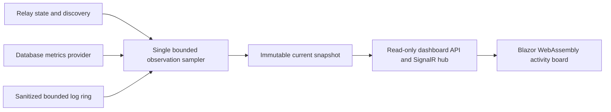

# PkRelay live dashboard

Status: first-version design, implementation and browser verification authorized by Paul's dashboard request and subsequent desktop/mobile testing instruction. Claude owns all commit, merge and push operations. Codex owns integration and built-in-browser verification; implementation scopes are assigned explicitly before edits.

## Purpose and experience

Paul's primary use is monitoring. It should look cool, simple and enjoyable, almost like a game, and work on other PCs and mobile devices. PkRelay serves a real Blazor WebAssembly application at `/dashboard/`, with same-origin SignalR updates. The hero is an activity board: machines are stable stations, sessions are selectable nodes and real observations produce brief signal pulses. A session inspector opens without leaving the board. A compact list presentation serves narrow screens and keyboard users. Plain labels retain the meaning of machines, sessions, reachability, freshness and activity.

The first version includes the activity board, a session observer with safe relay metadata, real-time request/response/push traffic, recent sanitized operational logs, provider-neutral SQL table/row metrics, and local presentation preferences for motion and theme. Paul additionally requested that traffic look attractive, subtle and not too flashy. The traffic lane uses short event-driven cues, paired request/response correlation and optional selected-session filtering; inspecting or scrolling pauses the visible window with an explicit resume action. Operational configuration is summarized read-only. Remote monitoring uses a viewer sign-in over HTTPS. A browser observer never opens an agent session, reads an agent's private inbox, acknowledges mail, acquires claims or queues wakes. Observer activity does not feed the agent activity counters.

The session observer shows lifecycle/last-seen information, mapping, reported freshness, unread counts when available, pending-effect counts and recent safe event summaries. Reachable means the relay's reported wake path is available; it does not mean a model is currently executing. Unsupported or unavailable measurements remain unknown rather than becoming zero. Message submission, delivery and acknowledgment are separate facts. UI motion freezes on disconnect or reduced-motion preference and never invents progress or a health score.

## Applying Simple Made Easy

The linked talk argues for disentangling independent concerns, treating data as values and reasoning about artifacts rather than equating familiarity with simplicity. Here that means an immutable observation snapshot, a transport that delivers it, a renderer that displays it, and a separately authorized settings boundary. Rendering does not call grains or control work. Provider-specific SQL collection stays behind a generic metrics contract. More files are acceptable when they remove hidden coupling; an event-sourcing platform or a dashboard-specific workflow engine is unnecessary.

Reference: [Rich Hickey, Simple Made Easy transcript](https://github.com/matthiasn/talk-transcripts/blob/master/Hickey_Rich/SimpleMadeEasy.md). These application choices are our design interpretation, not quotations from the talk.

## Existing boundaries verified

- The solution has seven .NET 10 projects; `Program.Main` composes the host through `AddRelayHost`, `UseRelayPipeline` and `MapRelayEndpoints`.
- `CoordinationHub.WatchSession` requires the exact private session handle; `WatchMachine` is scoped to the authenticated enrolled machine. The observer gets a separate hub and read API.
- `SqliteStore` exclusively owns the live database, serializes access with its gate and currently contains `grain_state`, `due_work` and `hub_metadata`. Metrics use that owner instead of opening another store or another hub.
- Host logging currently writes to the console. A bounded structured observer log sink can expose allowed diagnostic fields, with no headers, tokens, query strings, message bodies or grain payloads.
- Browser WebSockets cannot use arbitrary bearer headers, while PkRelay deliberately rejects query-string bearer tokens. A separate dashboard cookie avoids changing the existing agent authentication contract.

## First-version architecture



When the viewer allowlist is nonempty and at least one real dashboard stream is connected, a single host sampler produces a complete bounded snapshot every two seconds. It stays dormant without viewers; authenticated HTTP snapshot polling alone does not activate it. Database table metrics refresh less frequently, initially every 15 seconds. Complete snapshots deliberately avoid delta cursors, replay and partial-update races in the first version. Each has a process instance ID, monotonically increasing revision and server observation time. Reconnect always obtains the latest complete snapshot; older revisions for the same instance are ignored. A changed instance resets the revision baseline. A slow viewer skips intermediate snapshots and receives the latest, without unbounded queues or blocking relay writes. The UI shows connecting, live, reconnecting and stale states explicitly and retries both initial connection and later reconnects.

The sampler uses a sanitized read projection from the existing storage owner. Bounded raw envelope copies and indexed counts use short nonblocking gate phases; JSON decoding/projection occurs after the writer gate is released. Announced session grain keys have priority over historical rows, and public session identities are de-duplicated. It never returns arbitrary JSON payloads. Session/discovery data is joined by relay session ID. Read bounds and truncation flags are explicit; the initial maximum is 200 sessions, 32 tables and 200 recent log entries, with a 256 KiB serialized snapshot ceiling. Payload collection is one shared operation, not a scan per connected browser. Sampling failures retain the last good snapshot with warnings and stale timestamps, rather than failing coordination operations. Counters that cannot be derived reliably remain null. Detailed wake efficiency and model-token metrics are capabilities for later instrumentation, not fabricated numbers in version one. Machine inventory is explicit so an enrolled idle machine can remain a station. Session counts describe all observed rows independently of the returned window; `SessionsTruncated` explains a bounded list.

### Generic SQL metrics

The page is named SQL, not SQLite. The metrics port returns provider name, logical database name, collection time, size when supported, a bounded list of schema/table names and row counts, plus support/accuracy labels. A count can be exact, estimated, a lower bound or unavailable. The present SQLite adapter is the first implementation; browser components and contracts do not reference SQLite classes, files or pragmas. It reports real tables and rows, not logical task counts disguised as database rows. No row data, SQL console, vacuum, backup, schema change or arbitrary query execution is part of the viewer.

Collection is bounded and uses the store's gate without starving normal work. A capped row-count query is acceptable for the initial provider: a sample that reaches its configured cap is explicitly a lower bound. Expensive exact counts are not repeated on every SignalR frame. Busy collection is skipped with an explicit timestamp/warning. Provider-specific engine diagnostics can appear in optional details later.

## Frozen server/client contract

Add `PkRelay.Contracts/DashboardContracts.cs` with plain serializable records in namespace `PkRelay.Contracts.Dashboard`. Use the exact property names below; ASP.NET JSON uses camelCase on the wire. Arrays default to empty and nullable measurements mean unknown. The backend implementer may add optional properties but must coordinate renamed or removed fields with the client implementer.

```text
DashboardSnapshot: string InstanceId; long Revision; DateTimeOffset ObservedAt;
  DashboardHost Host; DashboardMachine[] Machines; DashboardSession[] Sessions;
  bool SessionsTruncated; DatabaseMetrics Database; DashboardLogEntry[] Logs;
  DashboardTrafficEvent[] Traffic; string[] Warnings
DashboardHost: string Name; DateTimeOffset StartedAt; string Version;
  int MachineCount; int SessionCount; int ReachableCount
DashboardMachine: string MachineId; string Name; bool Reachable;
  DateTimeOffset? LastSeenAt; int SessionCount
DashboardSession: string SessionId; string Label; string Provider; string MachineId;
  string MachineName; string RepositoryId; bool IsMapped; bool Reachable; bool IncarnationMismatch;
  DateTimeOffset? ReportedAt; DateTimeOffset? FreshUntil; int? UnreadMessages;
  int? PendingEffects; DateTimeOffset? LastActivityAt
DatabaseMetrics: string Provider; string Name; DateTimeOffset? ObservedAt;
  long? SizeBytes; DatabaseTableMetrics[] Tables; bool Truncated; string? Warning
DatabaseTableMetrics: string Schema; string Name; long? RowCount; string CountKind;
  long? SizeBytes
DashboardLogEntry: long Sequence; DateTimeOffset Timestamp; string Level;
  string Category; string Message; string? SessionId
DashboardAuthStatus: bool Authenticated; string? PrincipalId
DashboardTrafficEvent: long Sequence; DateTimeOffset Timestamp; string Kind;
  string Name; string? SessionId; string? Code; double? DurationMilliseconds;
  string? CorrelationId
```

Endpoints are under `/dashboard`: `GET api/auth`, `POST api/login`, `POST api/logout`, `GET api/snapshot`, and SignalR `hub` with `GetSnapshot()` plus server event `snapshot`. The first implementation can broadcast the latest sanitized snapshot to authenticated dashboard viewers once collected; it never uses the private coordination hub's groups. Snapshot and log bounds keep both the server's send buffer and the browser's memory finite. Login accepts `{ token: string }`; logout and login require matching same-origin requests. The client calls `api/auth` first and shows the sign-in screen on 401, without retrying failed authentication in a loop.

Real traffic is captured once at the logical `IRelayApplication` request/response boundary, using safe catalog tool names, opaque session IDs, result codes and elapsed time. A separate hook records an actual coordination push after the notifier sends it. A maximum of 120 recent traffic entries is retained inside the snapshot ceiling. Request and response entries share a correlation ID; no headers, request/response bodies, message text or credentials enter this ring. Dashboard authentication, snapshots and SignalR frames are not counted as agent traffic, preventing feedback from watching the dashboard.

## Viewer identity and privacy

The dashboard is an explicitly authorized INSTANCE-WIDE operator view, including global SQL metadata. `Relay:Dashboard:ViewerPrincipalIds` is an allowlist, empty by default. Sign-in requires both an existing enrolled administrator credential and an allowlisted principal ID; an ordinary machine or a repository-scoped administrator without that explicit observer grant is denied. This avoids pretending physical table counts can be filtered by repository. Repository filters in the UI are presentation only. The host exchanges the credential for a dedicated HttpOnly dashboard cookie with a 30-minute absolute lifetime after validating it server-side. The cookie authorizes only the dashboard scheme/endpoints and is never accepted by relay tool or private-agent hub endpoints. The credential is entered once, cleared immediately and never saved in browser storage, URLs, static assets or logs. Cookies use SameSite Strict and Secure for HTTPS; remote plaintext dashboard authentication is rejected. Explicit Origin checks protect the dashboard WebSocket, login and logout. Existing agent authentication stays unchanged.

Future dedicated viewer enrollments can use the same dashboard boundary without expanding the agent tool policy. Session secrets, bearer credentials, chat transcripts and message text are excluded by construction. Labels and logs render as text. The log ring accepts fixed allowlisted event templates and safe scalar fields, never arbitrary formatted application messages or exception text. Dashboard requests and sign-in requests must not produce recursive activity or log their request bodies. Authorization is revalidated on HTTP requests, hub calls and before periodic stream publication, so cookie expiry or removal of enrollment/observer grant closes or rejects the observer stream and shows sign-in again.

## Client and visual structure

Add `PkRelay.Dashboard` as a standalone .NET 10 Blazor WebAssembly client. PkRelay.Host serves its built static assets under `/dashboard/` and maps fallback only inside that route. Deep links and resource base paths must work. Existing `/mcp`, `/api/tools`, `/health`, `/scalar` and `/hubs/coordination` retain their routing and policy. Shared DTOs live in Contracts; the client references no Core, Storage or Orleans assembly.

The UI has one memorable activity board with restrained surrounding chrome. Desktop: board plus selected-session inspector; below it, a small event/log strip. Mobile: machine/session cards in a readable vertical flow, with the same selection behavior and details underneath. Navigation exposes Overview, Sessions, SQL and Logs. Preferences are local presentation state: theme and motion. Browser resizing never hides essential status or sign-in actions. Motion is sparse, cancelable and respects `prefers-reduced-motion`; optional signal pulses represent received observations. Disconnected data is visibly stale and never animated as fresh.

Palette direction: deep maritime blue, mist surfaces, a restrained gold selection accent and separate teal/amber/coral status marks, with readable light and dark appearances. Typography uses a locally available humanist sans; numeric values use tabular figures. Stable node placement and text/shape status cues give a game-board feeling without requiring physics, canvas rendering or a charting package. Table/list views remain available for precision and small screens.

## Game-board visual refinement

Paul reiterated the game-like direction after opening the preview. This is a visual refinement of the approved monitoring experience: machines become outposts/beacons on a calm strategy board and sessions become selectable tokens with readable identity badges. Thin routes convey actual relationships; brief event cues represent observed requests, responses and pushes. Maritime blue and mist remain the base, with gold selection and restrained teal/coral event accents. Keep the surrounding navigation, metrics and logs quiet. No invented score, levels, ambient progress or animation implies health or model execution.

The desktop overview places traffic beneath the board beside the inspector, using the open space under the board instead of waiting for the inspector's full height. Narrow screens retain a simple board, inspector, traffic reading order. Stable placement, long labels, explicit unavailable states, keyboard focus and reduced motion remain acceptance requirements. This direction is the implementer's choice within Paul's request; the new desktop/mobile screenshots are the reviewable result.

## Acceptance and implementation boundaries

1. A genuine WASM client is served by PkRelay and receives real same-origin SignalR snapshots after sign-in; two viewers do not create two samplers or relay sessions.
2. Actual sessions, reported reachability/freshness and available counts are visible; missing metrics remain unknown, and stale/disconnected UI remains honest.
3. The SQL view shows real table names and bounded/labeled row counts through the generic contract. Unknown provider metrics do not appear as zero.
4. Logs are bounded and sanitized, with no credentials, session secrets, message contents or arbitrary private-state export.
5. Viewer identity requires the explicit instance-wide observer grant and cannot invoke relay mutations. Remote monitoring uses HTTPS; existing private-agent auth and SignalR behavior still pass regression tests.
6. A collector or viewer failure does not stop accepted relay work. Browser memory, frame size and collector workload have explicit limits.
7. Built-in-browser smoke and visual-detail passes cover desktop and mobile widths, session selection, SQL/log navigation, sign-in/out, resizing, reduced motion and reconnect behavior. A Razor edit is trusted only after the generator exposes a new member and diagnostics are current.
8. Both Roslyn and Visual Studio MCP targets are checked. VS handles IDE operations; Roslyn handles semantics/diagnostics. Actual binary production and isolated-output tests are allowed. Nothing builds into the running hub or node output folders. Only Claude stages, commits, merges and pushes.

First delivery uses an isolated dashboard test host/database for destructive/reconnect checks, then a coordinated live deployment after tests. Browser viewport testing is desktop/mobile emulation, not a claim that a physical remote phone or LAN trust/firewall onboarding was exercised. Existing self-signed certificates include the hub hostname and local IPv4 addresses; other devices still need trusted HTTPS and network reachability.

## Sources

- [Blazor hosting models](https://learn.microsoft.com/aspnet/core/blazor/hosting-models?view=aspnetcore-10.0): WASM executes in the browser and is deployed as static assets.
- [Blazor WebAssembly hosting](https://learn.microsoft.com/aspnet/core/blazor/host-and-deploy/webassembly/?view=aspnetcore-10.0): publishing, base paths and asset serving.
- [SignalR authentication](https://learn.microsoft.com/aspnet/core/signalr/authn-and-authz?view=aspnetcore-10.0): browser cookies and the browser WebSocket bearer-header constraint.
- [SignalR groups](https://learn.microsoft.com/aspnet/core/signalr/groups?view=aspnetcore-10.0): group membership requires reconnect handling and does not establish authorization.

