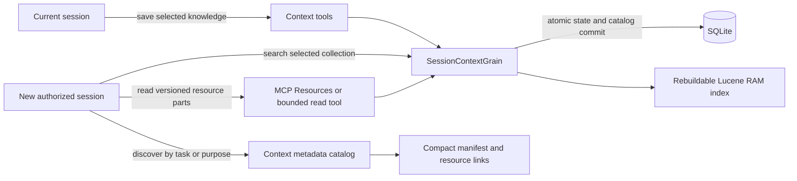

# Retained Searchable Session Context Design

**Status:** Proposed design prepared at Paul's request; implementation and deployment are outside this planning task.

**Intent:** Let a CoCern session save useful working knowledge outside the LLM's prompt, find it with the existing Lucene grain pattern, and hand it to another authorized session through bounded tools and MCP Resources.

## Decisions and scope

Paul requested retained searchable session context, reuse of CoCern's Lucene grain pattern, MCP Resources, and a way for a new session to pick up the context. The following choices are proposed implementation defaults, rather than additional requirements attributed to Paul.

- Retained context is deliberately published repository knowledge, with the same repository visibility as existing shared notes. Saving selected findings is explicit; this feature does not ingest complete private chat transcripts or credentials.
- A stable public `contextId`, separate from every `sessionId`, identifies a collection. The grain is keyed by a collision-safe encoding of canonical repository ID and context ID. A session may contribute to or read several collections.
- Repository-authorized sessions may read and update these collections under version checks, as with shared notes. A context ID, resource URI, label, previous session ID, or common principal is never an authentication secret or an execution grant.
- Retention survives inbox acknowledgment, session closure, adapter restart, hub restart and grain deactivation. Explicit forgetting and the existing coordinated database reset remove retained content. There is no automatic age-based deletion in the first release.
- Reuse Orleans, SQLite grain storage, Lucene.NET, the existing analyzers/chunking approach and Microsoft.ML.Tokenizers. No new packages, external vector database, embedding service, model calls or full-text engine migration are required.
- The first release searches one explicitly selected collection per call. Discovery uses a small persisted metadata catalog, avoiding activation of every historical session grain. Cross-collection semantic search, automatic memory extraction and private per-chat collections are later work.

## Existing implementation to build on

| Source | Relevant behavior |
| --- | --- |
| `src/CoCern.Core/DocSearchGrain.cs` | Lazy index construction, version-aware loading and patches, disposal on deactivation. |
| `src/CoCern.Core/DocSearchIndex.cs` | Lucene `RAMDirectory`, BM25 ranking, selective highlighting and bounded section results. |
| `src/CoCern.Core/CoordinationGrains.cs` | Persistent aggregate state, candidate-state commits, replay-safe operations and recovery after uncertain writes. |
| `src/CoCern.Domain/SessionAggregate.cs` | Inbox reads and acknowledgment; acknowledged bodies leave inbox state. This behavior must remain intact. |
| `src/CoCern.Domain/TaskBoardAggregate.cs` | Explicit shared notes with versions and provenance; retain their existing contracts. |
| `src/CoCern.Domain/SearchExtraction.cs` | Existing SQLite search indexes current tasks, notes and inbox contents. It is not a retained direct-message archive. |
| `src/CoCern.Storage/SqliteGrainStorage.cs` | Domain-derived state projections and indexes join the grain-state commit. |
| `src/CoCern.Adapter/WorkflowMcp.cs` | Currently registers only the static workflow resource and no dynamic templates. |
| `src/CoCern.Host/TokenCounter.cs` | Reused `o200k_base` tokenizer. Counts describe returned text, not total prompt usage or billing. |

## Architecture



`SessionContextGrain` is a new aggregate-backed persistent grain, independent of the expiring inbox-owning `SessionGrain`. It retains one bounded context collection and owns its derived in-memory Lucene index. Following the existing pattern does not mean embedding index files in serialized grain state or keeping every old grain permanently active.

SQLite stores the authoritative collection state and a small discovery projection in the same transaction. The metadata catalog contains no entry bodies. It lets a cold new session discover relevant collections without loading or indexing their contents. The existing task/note/inbox FTS index remains unchanged.

### Collection and entry model

A collection contains `contextId`, canonical `repositoryId`, `revision`, `title`, `summary`, `nextSteps`, `taskIds`, `pinnedEntryIds`, timestamps, deletion state and entries. Each entry has `entryId`, `version`, `kind`, `title`, `text`, optional `sourceRefs`, and hub-recorded author/session/time provenance. Entry kinds are `finding`, `decision`, `open_question`, `evidence` and `handoff`. The collection summary and next steps are explicitly authored, not generated on the server.

Entry versions use the collection's monotonically increasing revision at the last change. Deleting and recreating an entry ID never reuses its earlier version. Each created collection also receives a random persisted generation; exact entry URIs and pinned tool reads include it, so reset or generic storage clearing cannot make an old reference resolve to new content when numeric revisions restart. A deleted collection keeps a minimal replay/deletion tombstone and cannot be recreated under the same context ID; no retained body remains in the live state, search index or discovery catalog. Existing replay receipts retain only small result metadata, not copied entry bodies.

Proposed first-release bounds:

| Item | Limit |
| --- | --- |
| Context and entry ID | 64 ASCII characters, `[a-z0-9][a-z0-9._-]*`; IDs are exact and case-sensitive within a canonical repository. |
| Collection title / entry title | 160 UTF-16 code units each. |
| Current entries per collection | 64. |
| Entry text | 8,192 UTF-8 bytes, matching the existing message-report bound. |
| Serialized collection state | 1 MiB including metadata and bounded replay state; refuse further growth without evicting useful context. |
| Entry changes per mutation | 8 combined upserts/deletes and 32 KiB serialized patch maximum. |
| Related task IDs / pinned entry IDs | 8 each. |
| Summary / combined next steps | 400 / 200 `o200k_base` tokens. |
| Manifest | 1,200 tokens and 8 KiB, including metadata, summary, next steps and pinned entry references. |
| Search response | At most 5 hits, 160-token excerpts, 1,500 tokens and 8 KiB for the complete response. |
| Resource body part | At most 512 text tokens; complete read reply at most 1,500 tokens and 8 KiB. |
| Discovery page | At most 10 manifests' metadata; complete reply at most 1,500 tokens and 8 KiB. |

All limits must coexist with lower existing transport limits. Optional previews may be omitted to fit. Required summary/next-step fields that cannot fit cause a precise budget refusal at save time; never silently shorten decisions or discard entries. The number of collections is not held in one growing grain: discovery is an indexed SQLite query with bounded pages, and inactive collection indexes are reclaimable.

### Commit, replay and search consistency

Add an aggregate kind for retained session context and reuse the existing request replay/version machinery. A write needs the current session authorization, a stable request ID and expected collection revision (`0` only for creation). A repeated request returns its original small receipt; altered arguments under that request ID conflict. Public arguments cannot choose server provenance.

The candidate state, discovery projection and catalog revision commit atomically through the existing SQLite transaction. Domain read models supply the catalog projection; Storage does not independently reinterpret aggregate JSON. The discovery table is keyed by repository/context and indexed by repository and update time; bounded task associations support exact task filtering. A schema migration creates this projection and a catalog revision counter, preserving the existing pre-migration backup behavior.

Track the in-memory index's revision. Apply entry upserts/removals only after persistence succeeds. Any failed or uncertain commit leaves the prior searchable revision intact or invalidates the index until state reconciliation completes. A first search after activation rebuilds from committed collection state. Rebuild into a temporary index and swap it only when complete; a failure reports search unavailable without hiding the durable records. All index resources are disposed on deactivation. Forgetting removes indexed terms and prevents obsolete search hits or resource links being returned.

Create `SessionContextIndex` as a sibling of the document index. Reuse the analyzer, plain-word query handling, tokenizer, BM25 and selective snippet approach; use entry IDs and entry provenance directly. Do not represent memories as fake Git files or overload document commit identifiers. Keep document-search behavior unchanged. Small shared ranking/chunking primitives may be extracted only where needed; no document-search rewrite is part of this work.

## Tool contract

Add three worker tools. Keep existing `context_get` / `context_put`, `search`, `send_message` and inbox behavior compatible.

| Tool | Modes and result |
| --- | --- |
| `session_context_put` | Requires `contextId`, `expectedVersion` and existing mutation envelope. A patch atomically updates metadata and entries. `forget:true` is exclusive with a patch and deletes the collection. Returns IDs, revision, counts and manifest URI, without echoing bodies. |
| `session_context_get` | Without `contextId`, lists authorized repository catalog metadata, optionally filtered by exact `taskId`. With `contextId`, returns its compact manifest. With `contextId` and `entryId`, reads one versioned part. Mixed discovery/detail-only arguments are refused explicitly. |
| `session_context_search` | Requires `contextId` and plain-word `query`; optional bounded `limit`. Returns entry IDs, versions, kinds, excerpts, source references and exact resource URIs at a returned collection revision. |

`session_context_get` supports existing adapter-style `ifNoneMatch` for the exact read selection. Discovery uses an opaque cursor tied to the repository, filter, catalog revision and hub incarnation. A changed catalog or selection returns a restart result; an interrupted page is not an authoritative completed snapshot. Explicit entry reads carry `entryVersion` and `part`; an omitted version means current and the response supplies the exact version to retain for continuation.

Part boundaries are deterministic for the entry version and fixed tokenizer/chunker version. Replies name `generation`, `part`, `partCount` and `nextUri` when another part exists; pinned tool reads send that generation as `contextGeneration` alongside `entryVersion`. A read of a replaced/deleted version or wrong generation returns `ContextVersionUnavailable` or not-found; it never substitutes new text under an old versioned URI. The first release retains current versions only, not an unbounded version archive.

Reads do not create contexts, join chats, claim tasks, acknowledge messages or grant work authority. Tool profile selection follows existing worker/diagnostics/admin availability. The deliberately small `chat` profile remains unchanged; a chat needing retained-context tools uses an existing permitted worker profile.

## MCP Resources

Expose `text/markdown` resources with these URI templates:

```text
cocern://repositories/{repositoryId}/session-context/{contextId}/manifest
cocern://repositories/{repositoryId}/session-context/{contextId}/generations/{generation}/entries/{entryId}/versions/{entryVersion}/parts/{part}
```

Manifests contain the current summary, next steps, revision and pinned entry references. Entry resources contain one bounded part and provenance. IDs and path segments must be parsed canonically and validated; no filesystem paths, credentials or private native participant IDs are included.

Keep `resources/list` small: the static workflow resource remains listed, and dynamic contexts are discovered by `session_context_get` and search results. Advertise the two resource templates. Return SDK resource-link content alongside compact tool text where supported; avoid embedding the complete retained document twice. Resource links need not enumerate every dynamic item in `resources/list`.

Compose static workflow and dynamic resource handlers in one registration so they do not overwrite one another. Both the authenticated HTTP MCP host and stdio adapter use the same URI parser, authorization policy and bounded projection. The host calls the core read service directly. The adapter forwards a URI read through one new authenticated read-only hub route, `GET /api/session-context/resource?uri=...`, using its existing private transport credential. The route returns a protocol-neutral DTO; adapters convert it to MCP content.

Because all retained content in this release is repository-shared, resource reads authorize against current credential repository access and need no guessed acting-chat identity. A shared stdio process, last-used session, URI or label cannot establish private session access. If private memory is added later, it needs its own verified per-request identity design; it must not be enabled by changing a visibility flag here.

MCP Resources are application-driven. Resource support alone does not ensure an LLM can discover or read them, so tools provide equivalent bounded reads. No dependency on resource subscriptions, `list_changed` notifications or a protocol/SDK upgrade is needed for the first release. Follow the resource methods available in the currently negotiated protocol, including its missing-resource error semantics.

## How a new session picks up context

1. The new chat joins normally using its own existing CoCern connection. No old session handle or token is copied.
2. Startup/workflow guidance says that when resuming work without sufficient context, call `session_context_get` with the known task ID, or list the repository's bounded recent context metadata when the task is unknown.
3. Discovery returns public context IDs, purpose/title, related tasks, update time and manifest URIs. It does not return every entry or select ownership by label. When several candidates could match, return the choices; the agent resolves them against Paul's current task instead of silently taking the newest.
4. Read the selected manifest through MCP Resources or the equivalent tool. This gives a bounded handoff containing current summary, next steps and references to key decisions.
5. Search that collection for the specific remaining question; read only the relevant versioned parts. Check current task status, claims, controls, code and evidence before taking action: retained statements report past knowledge and do not renew old grants or prove present state.
6. Work under the new session's identity. At a meaningful milestone, update the collection under its current revision and leave a fresh summary/next step for the next session. Resolving an obsolete finding updates/removes it explicitly.

Same-chat compaction, replacement hub sessions and entirely new chats use this same discovery/read path. Remembered context IDs may skip discovery, but the read still authorizes and checks versions. Cross-provider and cross-PC handoff work through the shared repository catalog, without needing a common private native identity. Session closure does not remove context, and a database reset intentionally does; the new chat then sees no retained context rather than receiving invented recovery data.

## Lifecycle and observability

- Save useful findings or a checkpoint at significant milestones, before an intentional handoff and when correcting stale knowledge. Do not save a transcript or checkpoint on every turn.
- Saving is separate from sending and acknowledgment. A model may save a useful message as a selected entry and then acknowledge the message; neither operation silently performs the other.
- Forget entry content explicitly through a patch; forget a collection with `forget:true` under its expected revision. Current resource reads, discovery and search reflect the deletion. Existing backups and the established 24-hour mutation replay window keep their existing documented meaning; do not claim forensic deletion of historical database copies.
- The coordinated database reset must remove the new catalog and retained grain states atomically, alongside current coordination state. Deleting a row through normal runtime cleanup must invalidate its discovery projection in the same transaction.
- Reuse existing call-origin and token/call telemetry. Record bounded counts and sizes, manifest/search/read tokens, index rebuild duration, catalog queries, version conflicts and search-unavailable outcomes. Exclude bodies, queries and source text from new logs. Measure final model-facing projection, including resource reads, rather than assuming grain cache hits save prompt tokens.

## Acceptance and review

The feature is complete when session A can explicitly save a collection, close, and session B can discover the same collection, load a bounded manifest and retrieve the relevant evidence through either transport without A's credentials; a hub restart must preserve that result. Acknowledgment must retain its current inbox semantics independently.

Consolidate new automated coverage around three genuine boundaries: repository isolation across tools/resources/successor sessions; persistence and deletion across acknowledgment, closure, restart and failed commits; and replay/version consistency under updates and old resource references. Use existing document-search and authenticated MCP smoke coverage only when Roslyn maps the changed symbols to it. No TDD, per-task gates, whole-suite runs or unrelated test expansion. Source review is the safety net; execute the small related selection only at the major implementation/deploy milestone under `AGENTS.md` and `docs/testing.md`.

## References

- [MCP Resources specification](https://modelcontextprotocol.io/specification/2025-06-18/server/resources): URI resources, templates and application-controlled context inclusion. Use the protocol negotiated by the existing SDK, not new protocol features solely because they appear in a newer specification.
- [Orleans grain persistence](https://learn.microsoft.com/en-us/dotnet/orleans/grains/grain-persistence/): active state and durable persistence are separate from a rebuildable index.
- The source paths above and the companion implementation plan provide the repository-specific implementation map.
